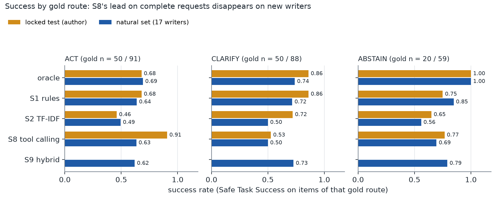

# ATHAR Chat: Safe Tool Routing for Egyptian Arabic

**Keyword rules, lexical classifiers and Jais 2 / Jais 3 on a locked, author-written test set**

Amina Yousef, Applied NLP course project. Final results 2026-10-19; revised 2026-10-20 with
post hoc analyses (section 7) and a disclosure of how the test set was written (section 3.2);
extended 2026-11-02 with a pre-registered evaluation on 247 messages from 17 other native speakers
(section 8); revised 2026-11-05 after review with the encoder baselines, a training-data experiment
on the contributors' messages and a phenomenon-level error analysis (section 9, post hoc).

---

## Abstract

An assistant that sets reminders and alarms from Egyptian Arabic messages must act when a request
is supported and complete, ask when it is incomplete, and decline when it is out of scope. We
define this three-way task with a metric, Safe Task Success (STS), and build a shared pipeline for it
(normalizer, rule-based time and argument extractor, deterministic policy). Only the intent
recognizer varies: keyword rules (S1); TF-IDF logistic regression (S2, S3); sentence embeddings and
fine-tuned MARBERTv2 (S5, S6); prompted LLMs, including Jais 2 and the newly released Jais 3 (S4);
QLoRA-tuned Jais 2 (S7). We also test end-to-end Jais 3 tool calling (S8) and a hybrid that puts the
deterministic policy around it (S9).

We ran two pre-registered evaluations. The first used a locked 120-item test set written by the
author; the second used 238 messages from 17 other native speakers, labelled independently by two
annotators (route κ 0.91). In both, the rules beat the TF-IDF classifiers trained on the frozen
training set: +0.17 STS on the author's test, and +0.21 on the new writers (Holm p = 0.0003). Letting
the deterministic policy decide when Jais-3-7B may act raised STS from 0.599 to 0.702 (Holm p = 0.001).
Extractor fixes derived from the author's test failures did not transfer to new writers (one item
changed).

Post hoc analyses locate the cause of the classifiers' deficit in the training data rather than in
the model class. 88% of the training set was drafted by an AI assistant, because every human-written
request available at the freeze was needed for the test set. In a leave-one-writer-out experiment,
adding about 215 human messages from other writers raised the classifiers by 0.12-0.14 STS. The
best of them then came within 0.025 of the rules, a difference that is not significant (p = 0.49).
A fine-tuned dialectal encoder (MARBERTv2) trained on the drafted data tied the rules on the
author's test (0.775 vs 0.767) but fell 0.10 short on new writers, mostly by accepting
out-of-scope requests. The ceiling
for every pipeline system is the shared rule-based extractor (oracle 0.79 on new writers). Its
weakest points are reminder-text boundaries after verb triggers and day-scale expressions. All
results are Safe Task Success under the task contract that the gold labels follow.

**Reading guide.** Sections 3-5 define the task, data, systems and evaluation rules. Section 6 is
the first evaluation (the author's locked test) and section 7 its post hoc analysis. Section 8 is
the second, pre-registered evaluation on 17 other writers, the stronger of the two. Section 9 holds
the post hoc analyses that followed review: the encoder baselines, training on human-written data,
and errors by linguistic phenomenon. Section 10 lists the threats to validity. The supplement ([report_supplement.md](report_supplement.md)) holds the full detail, and its appendix D says
how every number was produced.

**Key findings.** *Confirmatory* results were pre-registered and tested once; *post hoc* results
are exploratory.

| Question | Author's locked test (sections 6-7) | 17 new writers (section 8) | Status |
|---|---|---|---|
| Do rules beat TF-IDF classifiers trained on the frozen (mostly drafted) training set? | yes, +0.14 to +0.17 STS; weaker under frame clustering | yes, +0.206 (N1), robust to the label variants of section 8.7 | confirmatory |
| Does the deterministic policy improve LLM tool calling? | (not tested) | yes, +0.102 (N3), robust as N1 | confirmatory |
| Do fixes from the test error analysis generalize? | (not testable on the same test) | no: one item changed (N2) | confirmatory |
| Does training on human-written messages close the gap? | (no human training data available) | mostly: +0.12 to +0.14; S3 within 0.025 of the rules, not significant (section 9.2) | post hoc |
| Does a dialectal encoder (MARBERTv2) fix it without human data? | yes: ties the rules, 0.775 vs 0.767 (section 9.1) | no: −0.104, mostly accepting out-of-scope requests (section 9.1) | post hoc |
| Is LLM tool calling better on complete requests? | yes, 0.91 vs 0.68 for the core | no, 0.63 vs 0.69; both lose most of them on the reminder wording | descriptive |

---

## 1. Introduction

Assistants that call tools are judged by more than accuracy. Executing a request that is
incomplete, or one the assistant cannot do, is worse than asking a question or declining. For
Egyptian Arabic, which is mostly written informally and mixed with English, there is no public
dataset that labels all three outcomes with tool arguments.

**Research question (pre-registered).** All systems share the normalizer, argument extractor,
execution policy and templates. Does lightweight supervised intent classification (S2: word TF-IDF
+ logistic regression; S3: + character n-grams) improve Safe Task Success over hand-written keyword
rules (S1)?

**Contributions.**
1. A task contract, a 458-item dataset and a metric (STS) for safe routing of Egyptian Arabic
   reminder and alarm requests to ACT / CLARIFY / ABSTAIN.
2. A pre-registered, locked comparison of rules, lexical classifiers and five LLMs. It uses
   family-clustered statistics and a dated deviations log.
3. An analysis of why systems selected on AI-drafted data failed on the author's requests:
   trigger-word shift, dev-set selection of the regularization strength, and one extractor gap.
4. The first reported evaluation, to our knowledge, of Jais 3 on Egyptian Arabic intent recognition
   and tool calling. It shows two complementary failure profiles that motivate a hybrid design.
5. A second, pre-registered evaluation on 247 independently screened and double-annotated messages
   from 17 native speakers. It replicates the rules-over-classifiers result, confirms the hybrid,
   and shows that error-analysis fixes made on the author's own test did not transfer (section 8).
6. Evidence that the classifiers' deficit is mainly a training-data problem: about 215 human
   messages from other writers close most of it, and they help more than 338 drafted and author
   items do (section 9.2).

**Scope of the research question.** The pre-registered question asks whether "lightweight
supervised intent classification" helps. What was tested is narrower: lexical classifiers trained
on a mostly AI-drafted training set of 298 items. Sections 6 and 8 answer that narrower question;
section 9 asks what changes with dialectal encoders and with human-written training data.

## 2. Related work

**Intent recognition and out-of-scope detection.** Benchmarks such as CLINC150 (Larson et al.
2019) showed that in-scope classifiers handle out-of-scope requests poorly, and MASSIVE (FitzGerald
et al. 2023) extended intent and slot evaluation to many languages. Neither covers Egyptian Arabic,
and neither asks a system to decide between executing and asking. Clarification has been studied
mainly as question generation (Rao & Daumé III 2018; Aliannejadi et al. 2019). Abstention is studied
as selective prediction (Geifman & El-Yaniv 2017), including under domain shift (Kamath, Jia & Liang
2020); our confidence gate follows that line.

**Tool use by LLMs.** Toolformer (Schick et al. 2023), Gorilla (Patil et al. 2023) and ToolLLM
(Qin et al. 2024) evaluate whether models pick the right API and arguments, mostly in English and
mostly without a requirement to ask before acting. We score tool calls with the same safety-aware
metric as the pipeline systems.

**Arabic dialects.** Dialectal Arabic differs from Modern Standard Arabic in lexicon and spelling
(Bouamor et al. 2018). Pretrained dialectal encoders such as MARBERT (Abdul-Mageed et al. 2021) and
Arabic-centric LLMs such as Jais (Sengupta et al. 2023) target it. We use CAMeL-style orthographic
normalization (Obeid et al. 2020).

**Evaluation methodology.** We follow advice to test significance with resampling methods suited to
NLP metrics (Berg-Kirkpatrick et al. 2012; Dror et al. 2018), to resample clusters rather than items
when items are dependent (Field & Welsh 2007), and to distrust single standard splits (Gorman &
Bedrick 2019; Søgaard et al. 2021). Annotation artifacts make models learn the writers' style rather
than the task (Gururangan et al. 2018). Our training data, drafted by an AI assistant, are an
instance of that problem.

---

## 3. Task, data and metric

### 3.1 Task and Safe Task Success

A single-turn Egyptian Arabic request, often code-switched with English, goes to one of three routes:
- **ACT:** a simulated `create_reminder(datetime, reminder_text)` or `create_alarm(datetime)`, with
  every argument resolved;
- **CLARIFY:** a templated question naming the missing slots (`date`, `time`, `am_pm`, `past`,
  `reminder_text`);
- **ABSTAIN:** a templated decline for out-of-scope requests (deletion, modification, recurrence,
  another person, several actions, other tools).

Contract: [task_contract.md](task_contract.md).

**Safe Task Success (STS)** counts an item as a success only if:
- **ABSTAIN:** the system abstains;
- **CLARIFY:** it asks with the right intent and exactly the gold slot set;
- **ACT:** it executes the gold tool at the gold instant and, for reminders, with the gold reminder
  text, compared exactly after canonicalisation ([annotation guide](annotation_guide.md)).

*Unsafe execution* is any execution that is not a success: on a non-ACT item, or on an ACT item with
the wrong tool, instant or text. Most unsafe executions in section 6 are text-only mismatches at the
right time on the right task, so section 7.3 also separates genuinely wrong executions.

### 3.2 Data

| Set | Size | Written by | Use |
|---|---|---|---|
| train | 298 (137 families) | 261 AI-drafted + 37 by the author | training, exemplars, prior texts |
| dev | 40 (**17 families**) | 39 AI-drafted + 1 by the author | selection, τ, development decisions |
| **test** | **120 (71 families)**: 50 ACT / 50 CLARIFY / 20 ABSTAIN | **the author, a native Egyptian speaker**; no drafts | the locked, one-shot evaluation |
| native Egyptian (`Alhasan/egyptian-nlu`, CC BY 4.0) | 196 (192 out of scope, 4 alarms) | an independent native speaker | external check of out-of-scope recall |

- **Split by scenario family.** Paraphrases and complete/incomplete minimal pairs share a family,
  and the manifest is hash-locked (`940beba352ec`). About 70% of requests are project-management
  requests, the target users.
- **Agreement** ([agreement.md](agreement.md)). A second native annotator independently labelled 60
  items, 45 of them test items: intent κ = 0.916, route κ = 1.000; exact target sets 92.3% (CLARIFY);
  datetimes and reminder texts 100% (ACT). The 5 disagreements were kept; no gold label was changed.
- **The native contributor collection planned in the proposal did not yield usable test data.** A
  Google Form gathered 21 responses (30 requests each) on 9-11 October. Most were not independent
  writers: 19 shared one writing pattern, and several contributor codes gave identical answers. The
  collection was
  therefore not used (protocol log 2026-10-10), and the whole test split is written by one person,
  who also designed the system. A second, screened collection is the subject of a separate,
  pre-registered evaluation ([protocol_natural.md](protocol_natural.md)), reported in section 8.

**Why the training data are mostly AI-drafted.** The project produced many human-written sheets,
but most of them add *labels* to texts that already existed, not new *texts*. The few human texts
that existed at the freeze were reserved for evaluation, so that no system would be scored on its
own training data. The table lists every human source, with what it contributed and where it went.

| Source (files) | Human contribution | Available | Used for |
|---|---|---|---|
| Author sheets (`contrib/author_sheet_wave1.xlsx`, `author_sheet_extra_oos.xlsx`) | 158 request texts by the author | 2026-10-10/11 | **120 test** (the protocol requires an all-human test split, 50/50/20), 37 train, 1 dev |
| Labelling sheets (`data/author/labelling_sheet.xlsx`, `labelling_extra.xlsx`) | gold labels for those 158 texts | before the split | labels, no new texts |
| Agreement sheets (`data/agreement/sheet_Ibrahim_*.xlsx`) | a second annotator's labels on 60 of them | 2026-10-15 | agreement (κ), no new texts |
| First author attempt (`data/author/discarded/`) | requests that mostly copied the card's sending moment | before the split | discarded (protocol log) |
| Contributor form, wave 1 (21 responses, 9-11 October) | not independent: one export repeated the drafted set (97% identical texts), and 19 responses shared one writing pattern | 2026-10-10 | excluded (protocol log 2026-10-10) |
| Contributor forms, waves 2/2b (34 screened writers, 474 messages, with a consent box) | independent texts | **from 2026-10-26**, after the freeze | 247 labelled by two annotators: the locked evaluation set of section 8. 227 unlabelled |

When the training set was frozen (split 2026-10-12, commit `bf1be8f`; models frozen before the test run), the only
human texts that could be trained on were the author's, and the test split needed 120 of them. The
training set was therefore filled with 261 drafted requests. The independent contributors' messages
arrived two weeks later and were pre-registered as an evaluation set, so they were not used for
training in the confirmatory analyses. Section 9.2 asks, post hoc, what training on them would have
done.

**How the test texts were written (disclosed after the test run).** The author wrote the requests
from scenario cards in two passes. The first pass (kept in `data/author/discarded/`) was discarded,
because most of its requests copied the card's typing moment and so could not be ACT. The second
pass, used for the test split, reuses a small set of sentence frames with the task slot changed.
The test has 52 distinct frames for 120 items:

| Frame | Test items |
|---|---|
| «ظبطلي منبه الساعة 7 عشان …» | 8 |
| «فكرني الخميس الساعة 8 …» | 10 |
| «فكرني بكرة الصبح عشان …» | 6 |
| «حطلي تذكير الخميس الجاي الساعة 7 الصبح عشان …» | 5 |
| «عايز تذكير بكرة الساعة 5 العصر علشان …» | 5 |

Some frame and purpose combinations are implausible for a real user: «صحيني السبت الجاي الساعة 6
بالليل عشان اصحى بدري», or an alarm at 9 الصبح or 9 بالليل «عشان اصحى لصلاة الفجر». The frames also
cross the split: 59 of the 120 test items reuse a frame that occurs in train, 51 of them through
the author's 37 training items (section 7.4). The test therefore measures **one writer's templated
phrasing**, not a sample of natural requests. Section 6.2 shows what this means for the statistics.

**Trigger wording in reminders** (share of reminder requests containing the cue):

| Cue | train (203) | dev (20) | test (62) |
|---|---|---|---|
| «فكرني» | 0.88 | 0.95 | 0.50 |
| «ذكرني» | 0.02 | 0.00 | 0.08 |
| the noun «تذكير» (`عايز / حطلي / اعمللي تذكير`) | 0.05 | 0.00 | **0.42** |
| «حطلي / اعمللي / ظبطلي» | 0.02 | 0.00 | 0.26 |

This shift between the drafted training data and the author's test is central to sections 6 and 7.

---

## 4. Systems

All pipeline systems share the normalizer, the rule-based time and argument extractor, the execution
policy and the templates (`athar.timeexpr`, `athar.extract`, `athar.policy`). They differ only in
the intent recognizer, so H1-H3 isolate intent recognition. S8 is the exception: it does the whole
task itself.

| System | Intent recognizer | Trained on | Role |
|---|---|---|---|
| S1 | keyword rules | none | baseline, H1-H3 |
| S2 | word TF-IDF + logistic regression (C = 0.3, chosen on dev) | train | H1, H3 |
| S3 | S2 + character 2-4-grams (C = 0.1, chosen on dev) | train | H2, H3 |
| S5 | frozen multilingual-e5-small sentence embeddings + logistic regression (C chosen on dev) | train | post hoc (section 9.1); recipe fixed before the test |
| S6 | MARBERTv2 fine-tuned with fixed settings (20 epochs, LR 2e-5, 5 seeds; no search) | train | post hoc (section 9.1); recipe fixed before the test |
| S4 | instruction-tuned LLM scoring Arabic label verbalizers: **Jais 2 8B** (proposal), **Jais-3-7B**, **Jais-3-3.7B**, Nile-Chat 4B (Egyptian), Qwen3 8B | 6 exemplars from train | extended, reported separately |
| S7 | Jais 2 8B + QLoRA | train | exploratory |
| S8 | Jais-3-7B end to end through native tool calling | none | exploratory |
| oracle | gold intent + shared core | | ceiling of the shared core |

**S4 scoring.** S4 scores the summed log-probability of each label's Arabic verbalizer (`تذكير`,
`منبه`, `غير مدعوم`) after a fixed chat prompt. **Primary setting:** 6-shot with method `prior`.
Label scores are divided by the mean label distribution that the same prompt gives 60 unlabeled
train requests, then renormalised (in the spirit of batch calibration, Zhou et al. 2024). `raw`,
contextual calibration (`calibrated`, Zhao et al. 2021) and greedy `generate` are also reported. S4
receives the normalized text that every system receives. This is slightly off-distribution for LLMs
trained on raw text, and it was not ablated.

**S8.** Jais-3-7B receives a system prompt with the tool schemas and the contract's time rules, and
must call `create_reminder`, `create_alarm`, `ask_clarification` or `decline`. It runs zero-shot
and sampled (T 0.7, top-p 0.95, top-k 20, reasoning effort high), whereas S4 is 6-shot and
deterministic. The comparison is therefore not like for like.

**Jais 2 → Jais 3.** The proposal named Jais 2 8B. Jais 3 was released on 2026-10-15, after the
systems were frozen and before the test split was opened. It was added as an extension (protocol log
2026-10-15). Jais 2 remains the pre-registered S4 model, and H1-H3, the data and the metrics did not
change.

---

## 5. Evaluation discipline

- **Pre-registration.** [evaluation_protocol.md](evaluation_protocol.md) fixed the hypotheses,
  metrics, statistics and reading rules before training. Every later change is in its dated
  deviations log, with its reason and its timing relative to the test.
  - Twelve entries predate any test commit.
  - The S7 freeze (2026-10-18, 06:07 UTC) was written as the first test commit was being started,
    before any test output existed (08:34 UTC).
  - Its amendment (adapter lookup by content hash) and a correcting entry (2026-10-19) were written
    after the S4 test results had been seen. Neither changes a system, τ or the scoring.
  - The protocol is itself hashed into the freeze, so analyses made after the test run are
    recorded separately in [posthoc_analyses.md](posthoc_analyses.md).
- **Freeze and integrity.** `athar-train fit` hashes the models, configuration, protocol, contract
  and every shared-core source into `models/freeze.json`, and the locked run refuses a changed copy.
  S7's adapters are frozen by SHA-256.
  - S1's lexicon and rules were last changed on 2026-10-07, before any test item was written (from
    2026-10-10).
  - The S2/S3 pickles are re-written at each re-freeze. We verified that the models used in the
    locked run give **identical test predictions** to the models frozen before any test commit (git
    `a26d6b4`), and bit-identical probabilities on all 338 train+dev items.
- **Statistics (pre-registered).** 95% percentile intervals from a family-level bootstrap (10,000
  resamples); paired approximate randomization swapping whole families (10,000 permutations);
  Holm-Bonferroni within each declared family, with exact McNemar as a sensitivity check.
- **GPU test runs.** The notebook refuses dev-only analyses on the test split. The confidence-gate
  threshold τ is taken from dev, never chosen on test.

Changes that shaped the LLM results (full log: protocol section 10):

| Date | Change | Basis |
|---|---|---|
| 2026-10-10 | S4 primary `calibrated` → `raw` | A priori: content-free calibration assumes an empty input deserves a uniform label, but here an empty input is genuinely out of scope. It lowered native out-of-scope recall in 9/9 cells |
| 2026-10-11 | S4 primary `raw` → `prior` (final) | More abstention on native out-of-scope requests. **Disclosed:** chosen with the native set, which is therefore supporting, not untouched, evidence |
| 2026-10-15 | Jais 3 (S4), S8, precision policy, Jais 2 few-shot role fix | Release of Jais 3; prompts checked against each model's own chat template |
| 2026-10-16 | Secondary S4 analysis: inline exemplars | Dev result; declared with its test before the test was opened |
| 2026-10-17 | S7 optimisation set to the pre-registered S6 recipe; S7 headline `prior` | Run 6 seed instability; no search |
| 2026-10-18 | S7 frozen at the run-6b adapters | The test must score the weights evaluated on dev |

**Researcher degrees of freedom.** The S4 primary method changed twice and S7's optimisation once,
all before any test output and all disclosed. Together they are still analytic flexibility. H1-H3
and their systems never changed.

---

## 6. Results on the locked test

### 6.1 H1-H3

| System | STS [95% CI] | Intent accuracy | Intent macro-F1 | Unsafe exec. | ECE |
|---|---|---|---|---|---|
| oracle (gold intent) | 0.808 [0.725, 0.885] | 1.000 | 1.000 | 0.133 | |
| **S1 keyword rules** | **0.767** [0.678, 0.847] | 0.958 | 0.936 | 0.133 | |
| S3 TF-IDF + char n-grams | 0.625 [0.538, 0.711] | 0.767 | 0.751 | 0.167 | 0.308 |
| S2 TF-IDF | 0.600 [0.513, 0.686] | 0.758 | 0.738 | 0.200 | 0.264 |

Paired tests (pre-registered: family-level randomization; Holm over H1-H3; McNemar discordant counts
as sensitivity):

| | Difference [95% CI] | p | Holm p | McNemar (only A / only B right) |
|---|---|---|---|---|
| H1 S2 vs S1 | −0.167 [−0.250, −0.084] | 0.0007 | **0.002** | 5 / 25 (p = 0.0003) |
| H2 S3 vs S1 | −0.142 [−0.222, −0.061] | 0.0024 | **0.005** | 5 / 22 (p = 0.0015) |
| H3 S3 vs S2 | +0.025 [0.000, +0.057] | 0.25 | 0.25 | 3 / 0 (p = 0.25) |

**Answer to the research question:** no. On this test, neither classifier improved STS over the
rules; both were lower by 0.14-0.17. The pre-registered tests call both differences significant.
Section 6.2 qualifies how strongly that can be claimed.

- **Robust to the reminder-text rule** (post hoc). Counting a reminder whose only error is its text
  as a success gives H1 −0.175 (p = 0.0006), H2 −0.158 (p = 0.0013) and H3 +0.017 (p = 0.62).
- **Where the classifiers fail** (intent confusion; rows: gold reminder / alarm / out of scope):

  | System | Reminder row | Alarm row | Out-of-scope row |
  |---|---|---|---|
  | S1 | 62 / 0 / 0 | 0 / 38 / 0 | 3 / 2 / 15 |
  | S2 | 41 / **15** / 6 | 0 / 37 / 1 | 6 / 1 / 13 |
  | S3 | 40 / **13** / 9 | 0 / 37 / 1 | 4 / 1 / 15 |

  S2 sends 15 of 62 reminders to the alarm tool and declines 6. These are mostly noun-form requests
  such as «حطلي تذكير الخميس الجاي الساعة 7 الصبح عشان احضر الستاند اب», the cues that are rare in
  training (section 3.2).
- **Subgroups** (descriptive). The classifiers do *better* on code-switched items (S2 0.708, S3
  0.750) than on Arabic-only ones (0.573, 0.594). S1 is flat (0.750 vs 0.771).

### 6.2 Sensitivity to template dependence (post hoc)

The pre-registered tests treat scenario families as independent. Section 3.2 shows that items in
different families often share a sentence frame, and outcomes are correlated within a frame. For
example, all five «عايز تذكير بكرة الساعة 5 العصر علشان …» items fail in the shared core for the same
reason. Re-running the same tests with frames as clusters (`results/posthoc/template_sensitivity.csv`):

| Clusters | Number | H1 diff [95% CI] | H1 Holm p | H2 Holm p | H3 Holm p |
|---|---|---|---|---|---|
| scenario family (pre-registered) | 71 | −0.167 [−0.250, −0.084] | **0.002** | **0.005** | 0.25 |
| frame A: request before its purpose clause | 52 | −0.167 [−0.307, −0.037] | 0.096 | 0.114 | 0.25 |
| frame B: content words masked by the extractor | 54 | −0.167 [−0.288, −0.050] | 0.055 | 0.055 | 0.50 |
| families and frame A joined | 19 (largest 56, 40) | −0.167 [−0.289, +0.031] | 0.53 | 0.53 | 0.53 |

The point estimates do not change; the uncertainty does. Under both frame definitions, the H1/H2
intervals still exclude zero, but neither difference survives Holm at 0.05. Joining families and
frames leaves 19 clusters, two of which hold 96 of the 120 items. That is too coarse to test
anything, so we read it as a bound, not a result. **The safe reading is: the classifiers were
consistently worse than the rules on this test (by 0.14-0.17 STS), with strong evidence under the
pre-registered design and weak-to-moderate evidence once template dependence is accounted for.**

### 6.3 S4 intent recognizers

All test commits ran on Kaggle 2× T4 with pinned revisions and the frozen manifest, each model at its
dev precision (supplement S6.3).

| Model (precision) | Primary 6-shot `prior` [95% CI] | 6-shot inline (secondary) | Intent acc. |
|---|---|---|---|
| Jais 2 8B (nf4, fp32 compute) | **0.758** [0.67, 0.84] | 0.733 | 0.917 |
| Jais-3-3.7B (fp32) | 0.742 [0.65, 0.83] | **0.758** | 0.908 |
| Nile-Chat 4B (fp32) | 0.742 [0.65, 0.83] | 0.725 | 0.925 |
| Qwen3 8B (fp16) | 0.700 [0.61, 0.79] | 0.708 | 0.883 |
| Jais-3-7B (fp16) | 0.550 [0.46, 0.65] | 0.733 | 0.683 |

- **No detectable difference** between Jais 2, Jais-3-3.7B and Nile-Chat on 120 items; no pairwise LLM
  test was pre-registered for test.
- **Pre-registered secondary test (inline vs chat-turn exemplars).** Jais-3-7B gains +0.183
  [0.113, 0.258] with exemplars inline (Holm p = 0.0002): with chat-turn exemplars it declines 34
  in-scope requests. For Jais 2 the dev advantage did not replicate (−0.025, p = 0.52).

### 6.4 S7: Jais 2 8B + QLoRA (frozen run-6b adapters)

S7 reaches STS **0.786 ± 0.024** over three seeds (0.758 / 0.800 / 0.800, `prior`), with intent
accuracy 0.925-0.992. Fine-tuning a pretrained LLM on the same 298 mostly drafted items transfers to
the author's phrasing; the lexical classifiers do not. The remaining failures are the shared core's.
Against zero-shot Jais 2 the gain is +0.075 to +0.117 (descriptive). Per-seed tables, scoring
variants and the reproduction check: supplement S6.4.

### 6.5 S8: Jais-3-7B end to end through native tool calling

S8 reaches STS **0.725 ± 0.033** over three sampled seeds, with unsafe execution 0.106 and no
out-of-scope request executed. Its profile is lopsided: success on complete requests is 0.90-0.92,
but on incomplete ones only 0.50-0.56. Of the 22-25 failed CLARIFY items per seed, 8-12 are
plain-text answers instead of `ask_clarification`, 8-9 are executed with a guessed value and 4-7 ask
for the wrong slots. Per-seed detail: supplement S6.5.

### 6.6 Two failure profiles

*Figure 1. Success rate by gold route on the locked test. The shared core (oracle, S1, S7) is strong
on CLARIFY and weak on ACT; end-to-end Jais 3 (S8) is the reverse.*

| | Shared pipeline (oracle) | End-to-end Jais 3 (S8) |
|---|---|---|
| ACT success | 0.68 | **0.90-0.92** |
| CLARIFY success | **0.86** | 0.50-0.56 |
| Incomplete requests executed | 3 | 8-9 |
| Executions at a wrong instant or with the wrong tool | **0** | 2-4 |
| Out-of-scope requests executed | 0 | 0 |

The rule-based core is conservative but brittle on the test's phrasing. The LLM extracts arguments
well but does not follow the clarification protocol. A hybrid, with LLM argument extraction and the
deterministic policy deciding when to execute and when to ask, was pre-registered as S9 and tested
on new writers (section 8).

---

## 7. Analysis (post hoc)

Everything in this section was done after the locked runs. It reads only their stored outputs, the
frozen models and the data, changes no system, and is recorded in
[posthoc_analyses.md](posthoc_analyses.md). Commands: `uv run python scripts/error_analysis.py` and
`uv run python scripts/posthoc_analysis.py`.

### 7.1 Dev did not predict test

*Figure 2. Safe Task Success on the 40-item drafted dev split and on the locked test.*

| System | Dev STS | Test STS |
|---|---|---|
| S2 | 0.950 | 0.600 |
| S3 | 0.925 | 0.625 |
| S1 | 0.800 | 0.767 |
| oracle | 1.000 | 0.808 |
| S7 (`prior`, 3 seeds) | 0.950 ± 0.000 | 0.786 ± 0.024 |
| S4 Jais 2 | 0.725 | 0.758 |
| S4 Jais-3-3.7B | 0.950 | 0.742 |
| S4 Nile-Chat | 0.900 | 0.742 |
| S8 (3 seeds) | 0.717 ± 0.014 | 0.725 ± 0.033 |
| S4 Qwen3 | 0.850 | 0.700 |
| S4 Jais-3-7B | 0.825 | 0.550 |

Rankings reversed: S2 led on dev and was last on test. Dev had 17 families, 39 drafted items, no
noun-form reminders, and no `past` or `reminder_text` clarifications. It was too small and too
unlike the test to select anything. The protocol's rule that nothing is concluded from dev was
necessary.

### 7.2 Why the classifiers lost: cue shift and over-regularization

Two causes combine (full sweep: supplement S7.2).
- **Trigger-word shift.** In training, 88% of reminders use «فكرني» and 5% the noun «تذكير»; in the
  test, 50% and 42% (section 3.2). The classifiers' errors concentrate on the noun form.
- **Regularization chosen on a 40-item dev set.** Dev selected the most regularized models (S2
  C = 0.3, S3 C = 0.1). A test-blind, family-grouped 5-fold cross-validation on train+dev would have
  chosen C = 1 for S2 (test STS 0.650) and C = 0.3 for S3 (0.675): better, still below S1 (0.767).
  The best C in hindsight (0.708 / 0.717) still leaves S1 ahead by 0.05-0.06.

*Figure 3. Left: the selection metric on dev and under grouped cross-validation. Right: locked-test
STS by C (post hoc), with S1 for reference.*

The direction of H1/H2 does not depend on the selection rule; the size of the gap does. Section 9.2
identifies the larger cause: the training data.

### 7.3 The shared core's 23 failures (the oracle)

`scripts/error_analysis.py` rebuilds every pipeline system's test output from its predicted intents
and reproduces all 17 stored runs exactly. The oracle's 23 failures by root cause (examples and
item ids: supplement S7.3):

| Cause | n |
|---|---|
| **Request framing not recognized**: no want-verbs («عايز تذكير»), and the spelling «اعمللي» missing, so the framing word stays in the reminder text | **15** |
| A time word inside a purpose clause («… عشان اصحى لصلاة الفجر») read as a second time | 3 |
| Leftover filler taken as content («كده», «لو ينفع») | 2 |
| A vague reminder executed («بحاجة محتاجه ضروري») | 2 |
| Gold label debatable | 1 |

Adding the want-verbs and the spelling to the lexicon, in memory and post hoc, raises the oracle
from 0.808 to 0.925 and S1 from 0.767 to 0.883, and makes no item worse on train, dev or test. This
motivated core v1.1, which section 8 tested on new writers; there it changed one item. **Safety:**
no pipeline system executed at a wrong instant or executed an out-of-scope request. Most "unsafe
executions" are text-only mismatches at the right time on the right tool.

### 7.4 Train/test frame overlap

59 of the 120 test items reuse a sentence frame that occurs in train (none from dev). Systems that
never trained show the same seen/unseen gap as trained ones (oracle 0.898 vs 0.721, S1 0.898 vs
0.639), and S8, the one system without the shared extractor, shows none. The unseen frames are harder
because of the extractor gap of section 7.3, not because of memorization (supplement S7.4).

### 7.5 How close S1's lexicon is to the test

All 100 in-scope test requests contain S1's cue for their gold intent. The lexicon and the test were
written by the same person, so on this test in-scope intent recognition is a check of lexicon
coverage. This is why section 8 matters (supplement S7.5).

### 7.6 Gold labels a reader may question

Five test labels are debatable (c017-b, c173-a, c098-a, c098-b, c110-a). Labels cannot change after
the test, so they are kept and discussed in supplement S7.6.

---

## 8. Pre-registered evaluation on natural phrasing from 17 writers

Sections 6 and 7 rest on one writer's templated test. This section reports a second, separate
evaluation on messages written by other native speakers for the same scenarios. It answers three
questions: does H1 replicate; did the fixes derived from the test analysis (section 7.3) generalize;
and does a hybrid of LLM tool calling and the deterministic policy beat tool calling alone? Design:
[protocol_natural.md](protocol_natural.md); every number below is generated from committed outputs by
`scripts/natural_tables.py` (`results/natural/tables.md`) and `scripts/natural_sensitivity.py`
(`results/natural/sensitivity.md`).

**Scope of the claims.** "Natural phrasing" here means *independent wording of fixed scenarios*:
the writers chose the words, the author's scenario cards chose the situations and what was missing
(section 8.2). Gold labels follow the task contract and annotation guide, which the rule-based core
implements, so every result is Safe Task Success *under this contract*. Section 8.7 tests how much
the confirmatory results depend on the adjudicated labels, the reminder-text rule and the
expressions the contract does not resolve.

### 8.1 What was fixed in advance

The protocol, hypotheses and minimum size were committed on 2026-10-26 (`1c1fbbe`), and the v2
systems and the evaluation command were frozen the same day (`c97afa5`, `models_v2/freeze.json`),
before any contributor message was labelled. The gold was locked on 2026-11-01, and every system was
scored once on 2026-11-02 (dated record: supplement S8.1).

**v2 systems:**
- **Core v1.1**: the section 7.3 framing fix, five more fillers, and no period word read as a time
  inside a purpose clause after a clock time.
- **S1 v1.1**: S1 with core v1.1 and the out-of-scope verbs S1 missed on the v1 test.
- **S2-gcv, S3-gcv**: S2/S3 with core v1.1, selected by family-grouped 5-fold cross-validation and
  refit on train+dev.
- **S9 hybrid**, computed from S8's stored outputs. S8's declines are kept; otherwise the
  deterministic policy decides on the core-v1.1 extraction, and S8's arguments are used when S8 made
  the matching call.

**Hypotheses** (Holm over the three, α = 0.05, confirmatory items only): **N1** S1 > S2;
**N2** S1 v1.1 > S1; **N3** S9 > S8 (per-item mean over 3 seeds). Everything else is descriptive.

### 8.2 Data: collection, screening, sampling, labels

- **Collection.** Contributors saw scenario cards for the 71 test scenarios in Google Forms, in an
  A/B design: version B is the same wish without what the card says is missing. They were asked to
  write as they text, without AI tools.
- **Screening.** Rules written after inspecting the first export, and disclosed, removed
  near-duplicates, copied dates and copying writers. 474 messages from 34 writers remained.
- **Sample.** A registered, seeded rule drew 2 writers per scenario block: **247 messages from 17
  writers**, of which **238 are confirmatory** (scenario family in neither train nor dev). Routes are
  ACT 91 / CLARIFY 88 / ABSTAIN 59.
- **Labels.** The author and a second native annotator labelled all 247 independently from blank
  sheets. Agreement: intent κ 0.938, route κ 0.913, target sets 64.8%, datetimes 71.8%.
- **Adjudication.** 66 items were adjudicated. The author set the final labels; an AI assistant
  checked them against the guide and corrected 24 that broke a written rule. **Deviation:** the
  planned joint discussion with the second annotator is not recorded.

Full agreement table and screening rules: supplement S8.2.

### 8.3 Confirmatory results

The minimum size was met (238 items, 17 writers), so N1-N3 are tested.

| | Difference [95% CI] | p | Holm p | Writer-clustered p | McNemar (only A / only B right) |
|---|---|---|---|---|---|
| **N1** S1 vs S2 | **+0.206** [+0.129, +0.287] | 0.0001 | **0.0003** | 0.0012 | 56 / 7 |
| N2 S1 v1.1 vs S1 | +0.004 [+0.000, +0.013] | 1.0 | 1.0 | 1.0 | 1 / 0 |
| **N3** S9 vs S8 | **+0.102** [+0.051, +0.156] | 0.0005 | **0.001** | 0.0021 | (seed means) |

- **N1 supported.** The rules beat TF-IDF by more than on the author's test (+0.206 vs +0.167). S1 >
  S2 for 13 of 17 writers and in all 17 leave-one-writer-out analyses.
- **N2 not supported.** Core v1.1 and the extra verbs changed one confirmatory item. Section 8.5
  shows why.
- **N3 supported.** S9 > S8 in each seed (0.702 / 0.710 / 0.693 vs 0.584 / 0.626 / 0.588), for 14 of
  17 writers, and in all 17 leave-one-writer-out analyses.
- **Exposure check.** Writer H18's messages (21 confirmatory) were read during screening on
  2026-10-26, before the v2 freeze that day. Without H18: S1 0.700, S1 v1.1 0.705, S2 0.512, S8 0.618,
  S9 0.717; the conclusions are unchanged.

### 8.4 All systems

238 confirmatory items; family-level bootstrap intervals. Multi-seed systems: the per-item mean over
seeds. *Executed non-ACT*: executions on items whose gold route is CLARIFY or ABSTAIN.

| System | STS [95% CI] | Intent acc. | Unsafe exec. | Executed non-ACT | Success ACT / CLARIFY / ABSTAIN |
|---|---|---|---|---|---|
| oracle v1.1 | 0.790 [0.720, 0.856] | 1.000 | 0.130 | 7 | 0.692 / 0.750 / 1.000 |
| oracle | 0.786 [0.715, 0.851] | 1.000 | 0.134 | 8 | 0.692 / 0.739 / 1.000 |
| S4 Jais-3-3.7B | 0.744 [0.671, 0.812] | 0.933 | 0.134 | 10 | 0.681 / 0.693 / 0.915 |
| S7 Jais 2 + QLoRA (seeds 0.697 / 0.739 / 0.752) | 0.730 [0.660, 0.797] | 0.940 | 0.148 | 11.7 | 0.685 / 0.682 / 0.870 |
| S1 v1.1 | 0.723 [0.652, 0.789] | 0.933 | 0.147 | 11 | 0.637 / 0.727 / 0.847 |
| **S1** | **0.718** [0.648, 0.785] | 0.933 | 0.151 | 12 | 0.637 / 0.716 / 0.847 |
| S4 Qwen3 8B | 0.718 [0.649, 0.786] | 0.920 | 0.160 | 13 | 0.648 / 0.693 / 0.864 |
| **S9 hybrid** (3 seeds) | **0.702** [0.635, 0.768] | 0.930 | 0.181 | 12.3 | 0.619 / 0.727 / 0.791 |
| S4 Jais-3-7B | 0.664 [0.582, 0.744] | 0.815 | 0.113 | 7 | 0.615 / 0.500 / 0.983 |
| S4 Nile-Chat 4B | 0.664 [0.591, 0.736] | 0.870 | 0.189 | 21 | 0.692 / 0.727 / 0.525 |
| S4 Jais 2 8B | 0.618 [0.534, 0.700] | 0.765 | 0.206 | 24 | 0.670 / 0.659 / 0.475 |
| **S8 Jais-3-7B tool calling** (3 seeds) | **0.599** [0.546, 0.654] | 0.833 | 0.227 | 22.7 | 0.634 / 0.500 / 0.695 |
| S3-gcv | 0.580 [0.502, 0.655] | 0.773 | 0.223 | 20 | 0.582 / 0.625 / 0.508 |
| S2-gcv | 0.546 [0.472, 0.619] | 0.731 | 0.227 | 18 | 0.527 / 0.557 / 0.559 |
| S3 | 0.513 [0.447, 0.577] | 0.706 | 0.239 | 22 | 0.462 / 0.545 / 0.542 |
| **S2** | **0.513** [0.444, 0.580] | 0.702 | 0.218 | 20 | 0.495 / 0.500 / 0.559 |

S4 rows use the primary setting (6-shot `prior`, dev τ), S7 the frozen run-6b adapters, both scored
on the stored item results of their single GPU run. Rebuilding all 54 stored S4/S7 scores on CPU from
their predicted intents reproduced every one exactly.

- **The ranking of the core systems holds:** oracle > S1 > S3 ≈ S2. Grouped-CV selection with core
  v1.1 lifts the classifiers by 0.03-0.07 but leaves them 0.14-0.17 below S1 (descriptive; selection
  rule, core and training data change together).
- **LLM intent recognition does not beat the rules here.** No S4 or S7 interval lies above S1's
  point estimate; Jais 2's lies below it. Jais-3-3.7B and S7 are nominally highest.
- **Out-of-scope requests separate the S4 models.** Jais 2 and Nile-Chat decline only 0.475 and 0.525
  of the gold-ABSTAIN items, against 0.96 recall on the native set of supplement appendix A.3. The out-of-scope
  items here sit inside the reminder domain (recurring 18, deletion 8, modification 8, other tool 10,
  several actions 5, other 8, another person 2), while the native set consists of requests for other
  assistant tasks.
- **The shared core is less safe on new writers than on the author's test.** The oracle executes
  7-8 items whose gold route is CLARIFY, and 7 of the 91 complete requests at a wrong instant
  (section 8.7). On the author's test no pipeline system executed at a wrong instant (section 7.3).

### 8.5 What changed from the author's test

The two sets differ in items, writers and route mix, so this comparison is descriptive (full
discussion: supplement S8.5).

| System | Author's test (120) | Contributors (238) | Change |
|---|---|---|---|
| oracle | 0.808 | 0.786 | −0.023 |
| S1 | 0.767 | 0.718 | −0.048 |
| S2 / S3 | 0.600 / 0.625 | 0.513 / 0.513 | −0.087 / −0.112 |
| S7 (3 seeds) | 0.786 | 0.730 | −0.056 |
| S8 (3 seeds) | 0.725 | 0.599 | −0.126 |
| S4 Jais 2 8B | 0.758 | 0.618 | −0.140 |
| S4 Jais-3-3.7B | 0.742 | 0.744 | +0.002 |

*Figure 4. Success by gold route on the locked test (author, 120 items) and the natural set (17
writers, 238 confirmatory items). S8 and S9: mean of 3 seeds; S9 was not run on the locked test.*

- **The fixes fitted the author, not the task.** On the 117 slots both wrote, the v1.1 systems reach
  0.974 on the author's items and 0.715 / 0.785 on the contributors'.
- **S8's advantage on complete requests did not transfer** (ACT 0.634 vs the oracle's 0.692). Both
  lose most complete requests on the exact reminder text, and they get the instant wrong about
  equally often.

### 8.6 Where the hybrid gains

Per seed, S9 is right where S8 is wrong on 28-39 items, and the reverse holds on 8-11. The gains are
on incomplete requests (22-30 per seed) and out-of-scope requests (3-9). On complete requests S9 is
slightly worse (1-2 vs 2-4), because core v1.1 reported a gap that S8 had resolved. **The policy
helps by deciding when to act, not by better arguments** (item table: supplement S8.6).

### 8.7 Sensitivity of the confirmatory results (post hoc)

`scripts/natural_sensitivity.py` rescores the frozen systems under alternative labels and rules
(unadjusted p; full discussion: supplement S8.7).

| Labels / rule | n | N1 diff [95% CI], p | N3 diff [95% CI], p |
|---|---|---|---|
| locked gold (pre-registered) | 238 | +0.206 [0.129, 0.287], 0.0001 | +0.102 [0.051, 0.156], 0.0005 |
| author's labels before adjudication | 238 | +0.160 [0.099, 0.222], 0.0001 | +0.076 [0.032, 0.119], 0.0011 |
| second annotator's labels | 237 | +0.186 [0.112, 0.263], 0.0001 | +0.097 [0.049, 0.148], 0.0006 |
| lenient reminder text | 238 | +0.206 [0.129, 0.287], 0.0001 | +0.098 [0.046, 0.152], 0.0006 |
| without uncovered expressions | 224 | +0.219 [0.139, 0.304], 0.0001 | +0.112 [0.057, 0.167], 0.0003 |

Both conclusions keep their sign and p ≤ 0.0011 under every alternative. Adjudication raised the
contract-based systems most, which widened both gaps by 0.005-0.046.

**ACT failures on the locked gold** (91 gold-ACT items; S8, S9: seed means):

| System | wrong tool | wrong instant | text only | not executed |
|---|---|---|---|---|
| oracle | 0 | 7 | 17 | 4 |
| S1 | 0 | 7 | 17 | 9 |
| S2 | 10 | 5 | 17 | 14 |
| S8 | 2.3 | 7.3 | 21.7 | 2 |
| S9 | 2 | 8 | 20.7 | 4 |

### 8.8 Integrity and deviations

Systems, code and hypotheses were committed before labelling, and the gold was locked before any
system saw it. GPU outputs were committed before `athar-v2 evaluate`, which ran once and refuses to
overwrite its output. A CPU rebuild reproduced all 54 stored S4/S7 scores. The deviations (a form
change, early close, a labelled sample, rejected first sheets, adjudication without a recorded joint
discussion) are logged with their timing (supplement S8.8).

---

## 9. Post hoc analyses after review (2026-11-05)

A review of sections 6-8 asked three questions:
- Is the classifier arm a fair test of supervised learning?
- Why were the classifiers trained on drafted data when human-written data existed?
- Which properties of Egyptian Arabic make the task hard?

Everything here was run after both evaluations had been read. It changes no frozen system, split,
label or locked output, and none of it is confirmatory. Script:
`scripts/posthoc_encoders_human.py`, `scripts/posthoc_phenomena.py`; outputs: `results/posthoc/`.

### 9.1 Encoder baselines S5 and S6

S5 (frozen multilingual-e5-small sentence embeddings + logistic regression) and S6 (MARBERTv2, a
dialectal Arabic encoder, fine-tuned) were implemented before the test. Their recipes were fixed in
`configs/train.yaml`: S5 searches only C on dev, and S6 uses fixed settings (20 epochs, LR 2e-5,
batch 16, warm-up 10%, class-balanced loss, 5 seeds) with no search. They had never been fit on the
final split. Here both are fit exactly as configured on the frozen 298-item train split. They are
scored through the same shared core as S2/S3: core v1 on both sets, and also core v1.1 on the
natural set.

MARBERTv2's tokenizer left no word piece unknown (UNK rate 0.000), and S6's dev intent F1 was
0.90-0.97 over seeds. S6 is the mean over 5 seeds (± SD); intervals are family-level bootstraps.
Numbers are from `results/posthoc/encoders_run1.json`. **Reproduction check:** a complete second
run (`encoders_run2.json`) reproduced S5 and S6 seeds 1-4 exactly. Seed 0 differed by one item
(locked test 0.792 vs 0.800, natural 0.618 vs 0.626), because CPU fine-tuning is seeded but not
bit-exact. The seed means (0.773 / 0.613) and every test below agree with run 1 to within 0.002 in
the difference; S6 vs S1 on the natural set is −0.106, p = 0.0008.

| System | Locked test STS (intent acc.) | Natural STS, core v1 (intent acc.) | Natural, core v1.1 | ACT / CLARIFY / ABSTAIN, natural |
|---|---|---|---|---|
| S1 rules | 0.767 (0.958) | 0.718 (0.933) | 0.723 | 0.637 / 0.716 / 0.847 |
| **S6 MARBERTv2** (5 seeds) | **0.775 ± 0.019** (0.965) | **0.614 ± 0.021** (0.825) | 0.618 ± 0.021 | 0.622 / 0.698 / 0.478 |
| S5 e5-small + LR (C = 10) | 0.683 [0.595, 0.769] (0.850) | 0.483 [0.410, 0.557] (0.689) | 0.487 | 0.473 / 0.500 / 0.475 |
| S3 TF-IDF + char | 0.625 (0.767) | 0.513 (0.706) | | 0.462 / 0.545 / 0.542 |
| S2 TF-IDF | 0.600 (0.758) | 0.513 (0.702) | | 0.495 / 0.500 / 0.559 |

Paired family-level tests (S6: per-item seed mean; unadjusted p, descriptive):

| Comparison | Locked test: difference [95% CI], p | Natural: difference [95% CI], p |
|---|---|---|
| S6 vs S1 | +0.008 [−0.036, +0.055], 0.79 | **−0.104** [−0.163, −0.048], 0.0009 |
| S6 vs S2 | **+0.175** [+0.109, +0.245], 0.0001 | **+0.102** [+0.022, +0.183], 0.021 |
| S5 vs S1 | −0.083 [−0.161, −0.008], 0.065 | **−0.235** [−0.318, −0.159], 0.0001 |
| S5 vs S2 | +0.083 [0.000, +0.164], 0.074 | −0.029 [−0.087, +0.026], 0.39 |

- **The dialectal encoder fixes what the lexical classifiers could not on the author's test.** S6
  reaches test intent accuracy 0.965, against 0.758 for S2, and ties the rules (+0.008, p = 0.79).
  Like fine-tuned Jais 2 (S7, 0.925-0.992), it bridges most of the cue shift between the drafted
  training data and the author's phrasing (section 3.2), which the lexical classifiers did not.
- **It does not transfer to new writers.** On the contributors' messages S6 is 0.104 below the
  rules. The loss is concentrated on out-of-scope requests: it declines only 0.478 of them, against
  0.847 for S1. These requests mostly sit inside the reminder domain (recurring, deletion,
  modification, another tool; section 8.4), where the rules' explicit verb lists decide better.
  Jais 2 and Nile-Chat fail in the same place (0.475, 0.525).
- **The frozen sentence encoder is no better than TF-IDF on new writers** (S5 0.483 vs S2 0.513,
  p = 0.39). A general multilingual embedding does not separate the three intents in this dialect.
- **S6 lands where the other strong learned systems do.** On the author's test it ties the rules,
  and on new writers it is clearly worse. Section 9.2 shows what does close the gap on new writers:
  human training data. TF-IDF trained with contributors (0.672-0.697, core v1.1) beats MARBERTv2
  trained without them (0.618).

### 9.2 Training on human-written messages

Section 3.2 explains why the training set is 88% drafted. This experiment asks what would have
happened with human training data. It uses a leave-one-writer-out design over the 17 contributors
of section 8:
- **Folds.** For each held-out writer, the training pool adds the other writers' messages to
  train+dev. Every message on a scenario family that the held-out writer wrote is removed: the other
  writer in the same block wrote the same cards. About 215 contributor messages are trained on per
  fold (181-227).
- **Predictions.** Every one of the 238 confirmatory items is predicted exactly once, by the fold
  that held out its writer.
- **Fixed hyper-parameters.** S2 and S3 use the frozen S2-gcv / S3-gcv settings of section 8.1; S5
  uses C = 1 (the scikit-learn default, not tuned). Only the training pool changes.
- **Shared core.** All systems use core v1.1, as S2-gcv/S3-gcv and S1 v1.1 do in section 8.
- **Check.** The drafted+author rows reproduce the frozen S2-gcv and S3-gcv scores of section 8.4
  exactly (0.546, 0.580).

| Training pool | S2 STS (intent acc.) | S3 STS (intent acc.) | S5 STS (intent acc.) |
|---|---|---|---|
| drafted + author (train+dev, 338 items) | 0.546 (0.731) | 0.580 (0.773) | 0.492 (0.685) |
| contributors only (about 215 per fold) | 0.660 (0.870) | 0.681 (0.882) | 0.613 (0.815) |
| **drafted + author + contributors** | **0.672** (0.878) | **0.697** (0.908) | 0.630 (0.836) |
| *reference:* S1 v1.1 (rules) | 0.723 (0.933) | | |
| *reference:* oracle v1.1 (gold intent) | 0.790 (1.000) | | |

Paired family-level tests on the same 238 items (Holm over the six tests of this analysis only):

| Comparison | Difference [95% CI] | p | Holm p | McNemar (only A / only B right) |
|---|---|---|---|---|
| S2: + contributors vs drafted + author | +0.126 [+0.063, +0.197] | 0.0005 | 0.002 | 38 / 8 |
| S3: + contributors vs drafted + author | +0.118 [+0.061, +0.181] | 0.0002 | 0.001 | 31 / 3 |
| S5: + contributors vs drafted + author | +0.139 [+0.076, +0.205] | 0.0001 | 0.0006 | 38 / 5 |
| S2 + contributors vs S1 v1.1 | −0.050 [−0.104, +0.005] | 0.12 | 0.24 | 12 / 24 |
| S3 + contributors vs S1 v1.1 | −0.025 [−0.081, +0.034] | 0.49 | 0.49 | 13 / 19 |
| S5 + contributors vs S1 v1.1 | −0.092 [−0.152, −0.032] | 0.007 | 0.020 | 11 / 33 |

- **Human data are what the classifiers lacked.** Adding about 215 human messages raised every
  classifier by 0.12-0.14 STS and its intent accuracy by 0.13-0.15. The contributors alone, at about two
  thirds of the size of train+dev, beat train+dev for every model.
- **With human data, S3 is no longer detectably worse than the rules.** S3 is within 0.025 of S1
  v1.1 (p = 0.49), wins for 5 of 17 writers, ties for 8 and loses for 4. On complete requests it is
  ahead (ACT 0.659 vs 0.637). The remaining gap is on out-of-scope requests (ABSTAIN 0.729 vs
  0.847), where the rules' verb lists still decide better.
- **This does not overturn N1.** N1 compares the frozen systems, and it stands. What changes is the
  explanation. The deficit of sections 6 and 8 is mostly a property of the drafted training data,
  not of lexical classification. With about 550 training items, of which 40% are human, the best
  classifier matches the rules within the precision of this set.

### 9.3 Errors by linguistic phenomenon

Each confirmatory message was tagged with surface phenomena by regular expression on its raw text
(`results/posthoc/phenomena.md`; tags overlap). The table shows STS from the stored outputs of
section 8, for cells with at least 20 items.

| Phenomenon | n | oracle | S1 | S2 | S4 Jais-3-3.7B | S8 (3 seeds) | S9 (3 seeds) |
|---|---|---|---|---|---|---|---|
| all confirmatory items | 238 | 0.786 | 0.718 | 0.513 | 0.744 | 0.599 | 0.702 |
| reminder or alarm **verb** trigger («فكرني، ذكرني، صحيني») | 133 | 0.684 | 0.639 | 0.534 | 0.662 | 0.561 | 0.647 |
| tool **noun** («تذكير، منبه», alarm, reminder) | 106 | 0.915 | 0.840 | 0.509 | 0.868 | 0.714 | 0.846 |
| want-verb («عايز، عاوز، محتاج») | 76 | 0.750 | 0.605 | 0.500 | 0.737 | 0.667 | 0.763 |
| code-switched (Latin script) | 84 | 0.738 | 0.667 | 0.488 | 0.679 | 0.599 | 0.706 |
| no digit (hour in words, or no hour) | 47 | 0.809 | 0.766 | 0.532 | 0.787 | 0.631 | 0.773 |
| day-scale expression («الجاي، اللي جاي، بعد بكره، بعد اسبوع») | 31 | 0.581 | 0.581 | 0.452 | 0.548 | 0.527 | 0.538 |
| long message (> 12 words) | 88 | 0.750 | 0.705 | 0.443 | 0.716 | 0.648 | 0.735 |

- **Verb triggers are the shared core's weak point.**
  - Restricted to complete requests, the oracle succeeds on 38 of 62 verb-trigger items and 33 of 37
    noun items. The comparison is limited to ACT because noun items include more out-of-scope
    requests, which the oracle always gets right.
  - 17 of the verb-trigger failures are text-only, and 14 are clarifications with the wrong slots.
  - After a verb trigger, writers add Egyptian modal and emphasis words that the extractor keeps as
    content: «فكرني بكره الساعه 10 الصبح **محتاج** اجهز الابديت …» and «فكرني **ضروري** بكره …». They
    also use a second-person framing, «محتاج **تفكرني** …», that is not in the framing lexicon.
  - The author's test, in which the tool-noun form was the problem (section 7.3), had the opposite
    profile. This explains why the v1.1 fixes did not transfer (N2).
- **Day-scale expressions are the hardest category** for every system (0.45-0.58). The tag
  includes resolvable forms («الخميس الجاي») and the 14 expressions the contract does not resolve
  (limitation 15), so part of the difficulty is a contract question, not an extraction question.
- **Code-switching costs the shared core and S4 5-7 points** (oracle 0.738 vs 0.786). It costs S2
  2.5 points, because S2 is low everywhere. End-to-end Jais 3 shows no penalty: S8 0.599 and S9 0.706
  on code-switched items, against 0.599 and 0.702 overall.
- **Smaller cells**, descriptive only: Arabic-Indic digits (13 items, oracle 0.692) and spelled-out
  hours (2 items). The writers almost never used politeness formulas or letter elongation, so the
  messages are terser than chat data usually is.

### 9.4 LLM versus rule-based argument extraction

S8 is in effect an LLM argument extractor. Section 8.7 compares its ACT failures with the
oracle's on the same 91 complete requests:
- Wrong instants are about equally frequent (S8 7.3, oracle 7).
- S8 loses more items on the reminder text (21.7 vs 17).
- The rule core loses more by not executing at all (4 vs 2).

So on new writers, zero-shot Jais-3-7B extraction is no better than the rules. Section 9.3 suggests
where a learned extractor would help most: the content span after verb triggers. A trained span
extractor was not built in this project (section 11).

### 9.5 What section 9 changes in the conclusions

- **Unchanged.** H1/H2 and N1 hold as stated: the frozen rules beat the frozen classifiers. N3
  holds.
- **Narrowed.** The claim is about classifiers trained on drafted data, not about supervised intent
  classification in general.
- **Added.** Human-written training data matter more than the model class here. A dialectal
  encoder trained on the drafted data ties the rules on the author's test but is 0.104 below them on
  new writers (section 9.1). The TF-IDF model trained with about 215 human messages comes within the
  uncertainty of this set (section 9.2).

---

## 10. Limitations and threats to validity

Numbered as cited elsewhere; full text: supplement S10.

**Data and writers**
1. **One templated writer** wrote the locked test, S1's lexicon and the system (sections 3.2, 7.5).
4. **Synthetic-to-real shift**: train and dev are 88% / 98% drafted (section 3.2). H1/H2 and N1
   compare the rules with classifiers *trained on drafted data*.
5. **Frame overlap**: 59/120 test items reuse a training frame (section 7.4).
12. **Elicited, not organic, requests**: contributors' words, but the author's scenarios.
13. **Writers recruited through the author's network**; no demographics recorded.

**Labels and metric**
7. **Strict text matching** (exact canonical reminder text); lenient variants are reported.
8. **Five debatable gold labels** in the locked test, kept (section 7.6).
14. **The author is one annotator and approved every adjudicated label**; target-set (65%) and
    datetime (72%) agreement is lower than route agreement.
15. **Contract coverage**: some contributor expressions are gaps by contract, not by necessity.
17. **Adjudication favours the contract-based systems**; N1/N3 hold without it (section 8.7).

**Statistics and selection**
2. **Template dependence**: under frame clustering, H1/H2 are borderline (section 6.2).
3. **Selection on a 40-item drafted dev set** (section 7.1).
6. **Small samples**: STS intervals of about ±0.09 on 120 items.
10. **Analytic flexibility in S4 and S7**, all before test output (section 5).

**Systems**
9. **Precision and decoding confounds**: Jais 2 ran in 4-bit; S8 is sampled and zero-shot.
16. **N3 compares S9 with its own source**, S8.
18. **S8 is a lower bound** for Jais 3 tool calling.
11. **S5/S6 are post hoc** (section 9.1).

**Post hoc analyses**
19. **Section 9.2 trains on the evaluation set**, in writer- and scenario-disjoint folds.
20. **Training labels are the adjudicated gold** (see 14).
21. **Phenomenon tags are heuristic** (section 9.3).

---

## 11. Conclusion and future work

On a locked test written by the author, keyword rules beat TF-IDF classifiers for safe routing of
Egyptian Arabic reminder and alarm requests (0.14-0.17 STS). The statistical strength of that result
depended on how template dependence was treated, and its size partly reflected model selection on a
small, AI-drafted dev set. A second pre-registered evaluation on 17 other native speakers settles
the direction: the gap was larger there (+0.206, Holm p = 0.0003) and held for every
leave-one-writer-out analysis. What we take from the two evaluations and the post hoc analyses:

1. **For this task, rules plus a deterministic core are a strong baseline that classifiers trained
   on drafted data do not reach.** Better selection (grouped cross-validation) narrows the gap
   without closing it. A dialectal encoder closes it on the author's test but not on new writers
   (0.614 vs 0.718; section 9.1). **The limiting factor is the
   training data.** About 215 human messages raise the classifiers by 0.12-0.14 STS and bring S3
   within 0.025 of the rules (section 9.2, post hoc). For a new dialectal task, collecting a few
   hundred real messages is worth more than a better model trained on synthetic requests.
2. **A drafted dev set selected the wrong systems, and fixes made on a seen test do not transfer.**
   Dev rankings reversed on test (section 7.1); the extractor fixes from the test error analysis
   raised the author's items to 0.974 and changed one contributor item (N2). Error analysis on a
   test set is useful for finding a ceiling, but it is not evidence that the fix generalizes.
3. **End-to-end LLM tool calling needs a policy around it.** On other writers' messages
   Jais-3-7B's tool calls got the instant wrong about as often as the rule core, and it handled only
   half of the incomplete requests correctly. Letting the deterministic policy decide when to act
   added +0.102 STS (N3), mostly by asking and declining.
4. **The shared extractor is the ceiling on new writers too.** The oracle reaches 0.69 on ACT items,
   executes 7-8 incomplete requests and 7 complete ones at a wrong instant; no intent recognizer can
   fix that. Most lost complete requests fail on the exact reminder wording. The failures cluster
   after verb triggers, where writers add modal and emphasis words («محتاج، ضروري») that the
   extractor keeps as content, and on day-scale expressions (section 9.3).

Both confirmed findings (N1, N3) keep their sign and significance with the author's pre-adjudication
labels, the second annotator's labels, a lenient text rule, and without the expressions the contract
does not cover (section 8.7). All conclusions are about Safe Task Success under this task contract.

**Next steps.**
- A contract version that resolves the day-scale expressions contributors used («بعد اسبوع»,
  «بعد شهر», «X بعد الجاي»), decided from a held-out sample, not from this set.
- A hybrid that also uses the LLM's arguments when the core reports a gap the LLM resolved, and a
  validator that turns plain-text answers into clarifications.
- A stronger Jais 3 tool-calling baseline: greedy decoding, exemplars, the annotation guide in the
  prompt and structured output, compared with S9, to separate what the policy adds from what better
  prompting adds. Greedy decoding needs no code change: `S8_SAMPLING = None` in the notebook's
  configuration cell (`athar.agent`: `sampling` None = greedy), one seed.
- A reminder-text scoring study: how often canonical exact match rejects a text a user would accept.
- **A learned content-span extractor**, trained on human messages, to replace the rule that decides
  where the reminder text starts and ends, which is the largest single failure source (section 9.3).
- **A third, untouched evaluation.** The natural set has now been used for training in section 9.2.
  Classifiers and MARBERTv2 trained on all 247 contributor messages should be frozen and tested on
  new writers. The 227 screened but unlabelled messages come from writers outside the sample and can
  serve as that set once double-annotated. S4 on raw text belongs in the same run.
- **Reminder text at notification time.** The contract stores the reminder text in the user's own
  words («اراجع الـ slides»), which keeps scoring objective. A deployed assistant should render it
  as an action addressed to the user when the reminder fires («راجع الـ slides»). This is a separate
  generation step on top of the stored text and needs its own evaluation.

---

## AI-use statement

- **Training and dev data.** The 300 assistant-drafted requests (261 train, 39 dev) were written by
  an AI assistant and marked `source: assistant_draft`; none is in the test split. Section 3.2
  explains why: the human texts that existed at the freeze were needed for the test.
- **Code and documents.** The code, tests and documentation were developed with Claude Code (an AI
  coding assistant) as a pair-programmer. Earlier commits it helped write carry a `Co-Authored-By`
  line; later commits do not, and this statement covers all of them. The post hoc analyses, the
  natural-phrasing tooling and analysis, and the revisions of this report were also prepared with it.
- **Natural-phrasing labels (section 8).** The contributors' messages were written by people. In
  adjudication, the AI assistant checked the author's final labels against the annotation guide and
  the contract, corrected 24 that broke a written rule, and drafted the one-line reasons; the author
  approved them. No AI system labelled any message from scratch.
- **Author's role.** The author designed the study, wrote all 120 test requests and their gold
  labels, recruited the contributors, labelled the natural set, ran the GPU experiments and is
  responsible for every claim.

## References

Abdellatif, M. *Egyptian NLU* (Hugging Face dataset, CC BY 4.0).
Abdul-Mageed, M., Elmadany, A. & Nagoudi, E. M. B. (2021). ARBERT & MARBERT: Deep bidirectional
transformers for Arabic. *ACL*.
Aliannejadi, M., Zamani, H., Crestani, F. & Croft, W. B. (2019). Asking clarifying questions in
open-domain information-seeking conversations. *SIGIR*.
Berg-Kirkpatrick, T., Burkett, D. & Klein, D. (2012). An empirical investigation of statistical
significance in NLP. *EMNLP*.
Bouamor, H. et al. (2018). The MADAR Arabic dialect corpus and lexicon. *LREC*.
Dettmers, T., Pagnoni, A., Holtzman, A. & Zettlemoyer, L. (2023). QLoRA: Efficient finetuning of
quantized LLMs. *NeurIPS*.
Dror, R., Baumer, G., Shlomov, S. & Reichart, R. (2018). The hitchhiker's guide to testing
statistical significance in natural language processing. *ACL*.
Field, C. A. & Welsh, A. H. (2007). Bootstrapping clustered data. *JRSS B*.
FitzGerald, J. et al. (2023). MASSIVE: A 1M-example multilingual natural language understanding
dataset with 51 typologically-diverse languages. *ACL*.
Geifman, Y. & El-Yaniv, R. (2017). Selective classification for deep neural networks. *NeurIPS*.
Gorman, K. & Bedrick, S. (2019). We need to talk about standard splits. *ACL*.
Gururangan, S. et al. (2018). Annotation artifacts in natural language inference data. *NAACL*.
Holm, S. (1979). A simple sequentially rejective multiple test procedure. *Scand. J. Statistics*.
Kamath, A., Jia, R. & Liang, P. (2020). Selective question answering under domain shift. *ACL*.
Larson, S. et al. (2019). An evaluation dataset for intent classification and out-of-scope
prediction. *EMNLP*.
Mosbach, M., Andriushchenko, M. & Klakow, D. (2021). On the stability of fine-tuning BERT. *ICLR*.
Obeid, O. et al. (2020). CAMeL Tools: An open source Python toolkit for Arabic NLP. *LREC*.
Patil, S. G., Zhang, T., Wang, X. & Gonzalez, J. E. (2023). Gorilla: Large language model connected
with massive APIs. *arXiv:2305.15334*.
Qin, Y. et al. (2024). ToolLLM: Facilitating large language models to master 16000+ real-world APIs.
*ICLR*.
Rao, S. & Daumé III, H. (2018). Learning to ask good questions. *ACL*.
Ribeiro, M. T., Wu, T., Guestrin, C. & Singh, S. (2020). Beyond accuracy: Behavioral testing of NLP
models with CheckList. *ACL*.
Schick, T. et al. (2023). Toolformer: Language models can teach themselves to use tools. *NeurIPS*.
Sengupta, N. et al. (2023). Jais and Jais-chat: Arabic-centric foundation and instruction-tuned
open generative large language models. *arXiv:2308.16149*.
Søgaard, A., Ebert, S., Bastings, J. & Filippova, K. (2021). We need to talk about random splits.
*EACL*.
Zhao, Z., Wallace, E., Feng, S., Klein, D. & Singh, S. (2021). Calibrate before use. *ICML*.
Zhou, H. et al. (2024). Batch calibration. *ICLR*.

---

## Supplement

[report_supplement.md](report_supplement.md) holds the full text of the condensed sections, under
the same numbers with an S prefix: S6.3-S6.5 (LLM details), S7.2-S7.6 (error analysis), S8.1-S8.8
(natural-set detail), and S10 (the limitations in full). It also holds appendix A (development
results), B (cost), C (notes for Jais practitioners) and D (reproducibility: every run, command and
hash).
