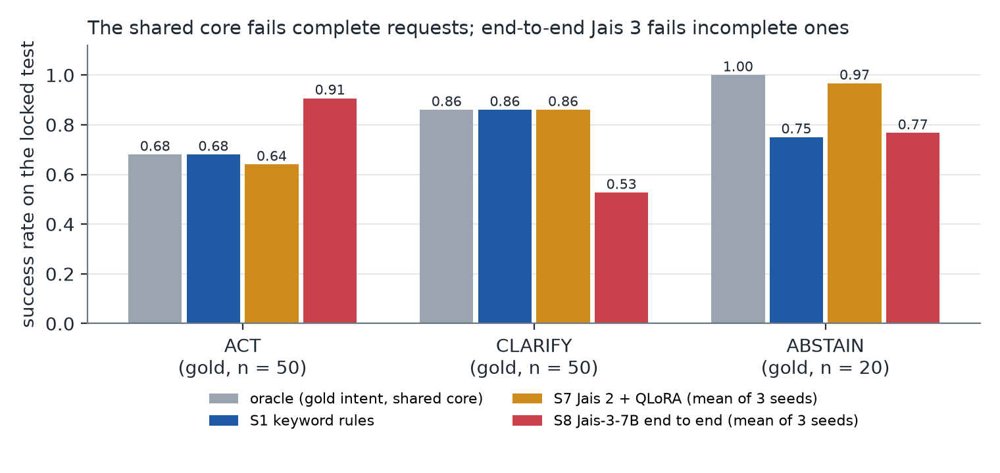
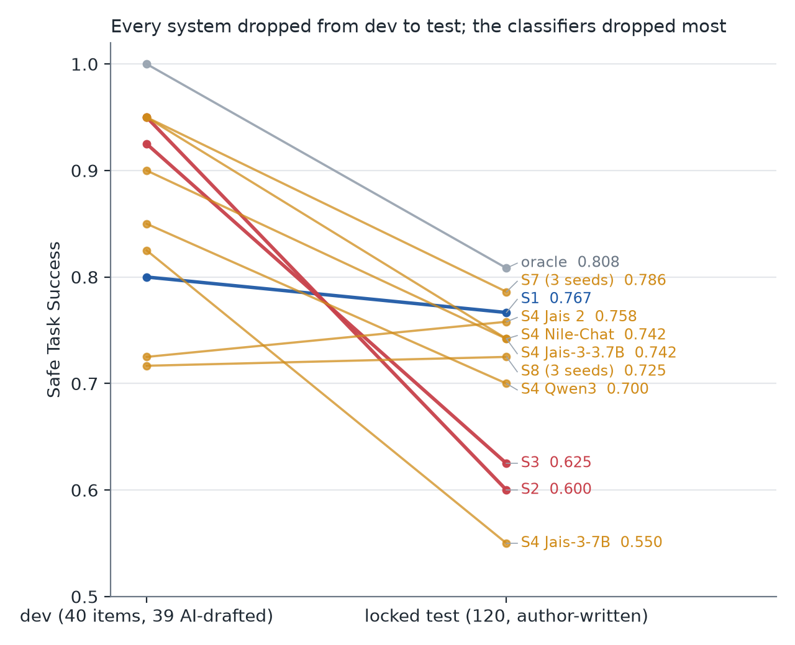
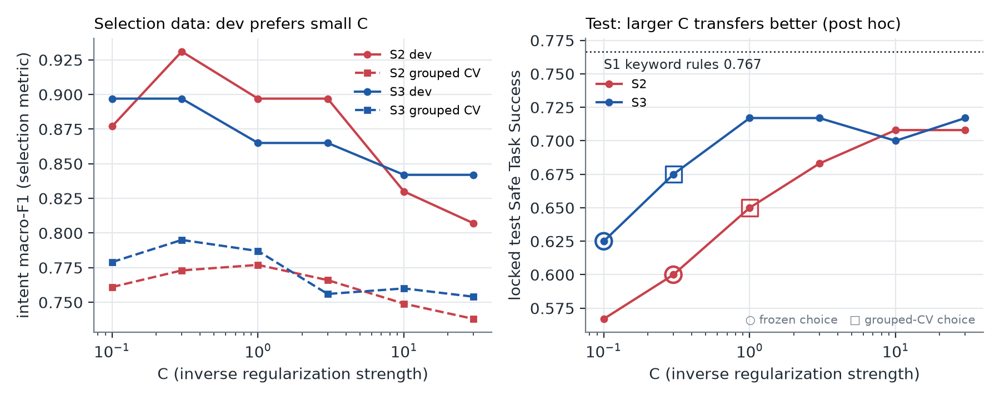

# ATHAR Chat: Safe Tool Routing for Egyptian Arabic

**Keyword rules, lexical classifiers and Jais 2 / Jais 3 on a locked, author-written test set**

Amina Yousef, Applied NLP course project. Final results 2026-10-19; revised 2026-10-20 with
post hoc analyses (section 7) and a disclosure of how the test set was written (section 3.2).

---

## Abstract

An assistant that sets reminders and alarms from Egyptian Arabic messages must do three things:
act when a request is supported and complete, ask when it is incomplete, and decline when it is
out of scope. We build a shared pipeline for this (normalizer, rule-based time and argument
extractor, deterministic policy) and vary only the intent recognizer: keyword rules (S1), TF-IDF
logistic regression (S2, S3), prompted LLMs including Jais 2 and the newly released Jais 3 (S4),
QLoRA-tuned Jais 2 (S7), and end-to-end Jais 3 tool calling (S8). We score them with a
pre-registered metric, Safe Task Success (STS), on a locked 120-item test set written by the author.

On that test, the rules (STS 0.767) beat both classifiers (0.600, 0.625). The difference is
significant under the pre-registered family-clustered test, but only borderline once items that
share a sentence frame are also treated as dependent. Post hoc analyses explain the gap. The
training data are 88% AI-drafted and use different trigger wording from the test, and model
selection on a 40-item drafted dev set chose over-regularized classifiers. The ceiling for every
pipeline system is the shared extractor (0.808 with gold intents). Its failures come almost
entirely from one framing-lexicon gap; fixing it would raise that ceiling to 0.925. End-to-end
Jais 3 fails in the complementary place: it extracts arguments well but often does not ask when it
should. The test set is one writer's templated phrasing, so all conclusions are about that
distribution.

---

## 1. Introduction

Assistants that call tools are judged by more than accuracy. Executing a request that is
incomplete, or one the assistant cannot do, is worse than asking a question or declining. For
Egyptian Arabic, which is mostly written informally and mixed with English, there is no public
dataset that labels all three outcomes with tool arguments.

**Research question (pre-registered).** All systems share the normalizer, argument extractor,
execution policy and templates. Does lightweight supervised intent classification (S2: word TF-IDF
+ logistic regression; S3: + character n-grams) improve Safe Task Success over hand-written keyword
rules (S1)?

**Contributions.**
1. A task contract, a 458-item dataset and a metric (STS) for safe routing of Egyptian Arabic
   reminder and alarm requests to ACT / CLARIFY / ABSTAIN.
2. A pre-registered, locked comparison of rules, lexical classifiers and five LLMs. It uses
   family-clustered statistics and a dated deviations log.
3. An analysis of why systems selected on AI-drafted data failed on the author's requests:
   trigger-word shift, dev-set selection of the regularization strength, and one extractor gap.
4. The first reported evaluation, to our knowledge, of Jais 3 on Egyptian Arabic intent recognition
   and tool calling. It shows two complementary failure profiles that motivate a hybrid design.

## 2. Related work

**Intent recognition and out-of-scope detection.** Benchmarks such as CLINC150 (Larson et al.
2019) showed that in-scope classifiers handle out-of-scope requests poorly, and MASSIVE (FitzGerald
et al. 2023) extended intent and slot evaluation to many languages. Neither covers Egyptian Arabic,
and neither asks a system to decide between executing and asking. Clarification has been studied
mainly as question generation (Rao & Daumé III 2018; Aliannejadi et al. 2019). Abstention is studied
as selective prediction (Geifman & El-Yaniv 2017), including under domain shift (Kamath, Jia & Liang
2020); our confidence gate follows that line.

**Tool use by LLMs.** Toolformer (Schick et al. 2023), Gorilla (Patil et al. 2023) and ToolLLM
(Qin et al. 2024) evaluate whether models pick the right API and arguments, mostly in English and
mostly without a requirement to ask before acting. We score tool calls with the same safety-aware
metric as the pipeline systems.

**Arabic dialects.** Dialectal Arabic differs from Modern Standard Arabic in lexicon and spelling
(Bouamor et al. 2018). Pretrained dialectal encoders such as MARBERT (Abdul-Mageed et al. 2021) and
Arabic-centric LLMs such as Jais (Sengupta et al. 2023) target it. We use CAMeL-style orthographic
normalization (Obeid et al. 2020).

**Evaluation methodology.** We follow advice to test significance with resampling methods suited to
NLP metrics (Berg-Kirkpatrick et al. 2012; Dror et al. 2018), to resample clusters rather than items
when items are dependent (Field & Welsh 2007), and to distrust single standard splits (Gorman &
Bedrick 2019; Søgaard et al. 2021). Annotation artifacts make models learn the writers' style rather
than the task (Gururangan et al. 2018). Our training data, drafted by an AI assistant, are an
instance of that problem.

---

## 3. Task, data and metric

### 3.1 Task and Safe Task Success

A single-turn Egyptian Arabic request, often code-switched with English, goes to one of three routes:
- **ACT:** a simulated `create_reminder(datetime, reminder_text)` or `create_alarm(datetime)`, with
  every argument resolved;
- **CLARIFY:** a templated question naming the missing slots (`date`, `time`, `am_pm`, `past`,
  `reminder_text`);
- **ABSTAIN:** a templated decline for out-of-scope requests (deletion, modification, recurrence,
  another person, several actions, other tools).

Contract: [task_contract.md](task_contract.md).

**Safe Task Success (STS)** counts an item as a success only if:
- **ABSTAIN:** the system abstains;
- **CLARIFY:** it asks with the right intent and exactly the gold slot set;
- **ACT:** it executes the gold tool at the gold instant and, for reminders, with the gold reminder
  text, compared exactly after canonicalisation ([annotation guide](annotation_guide.md)).

*Unsafe execution* is any execution that is not a success: on a non-ACT item, or on an ACT item with
the wrong tool, instant or text. Most unsafe executions in section 6 are text-only mismatches at the
right time on the right task, so section 7.3 also separates genuinely wrong executions.

### 3.2 Data

| Set | Size | Written by | Use |
|---|---|---|---|
| train | 298 (137 families) | 261 AI-drafted + 37 by the author | training, exemplars, prior texts |
| dev | 40 (**17 families**) | 39 AI-drafted + 1 by the author | selection, τ, development decisions |
| **test** | **120 (71 families)**: 50 ACT / 50 CLARIFY / 20 ABSTAIN | **the author, a native Egyptian speaker**; no drafts | the locked, one-shot evaluation |
| native Egyptian (`Alhasan/egyptian-nlu`, CC BY 4.0) | 196 (192 out of scope, 4 alarms) | an independent native speaker | external check of out-of-scope recall |

- **Split by scenario family.** Paraphrases and complete/incomplete minimal pairs share a family,
  and the manifest is hash-locked (`940beba352ec`). About 70% of requests are project-management
  requests, the target users.
- **Agreement** ([agreement.md](agreement.md)). A second native annotator independently labelled 60
  items, 45 of them test items: intent κ = 0.916, route κ = 1.000; exact target sets 92.3% (CLARIFY);
  datetimes and reminder texts 100% (ACT). The 5 disagreements were kept; no gold label was changed.
- **The native contributor collection planned in the proposal did not yield usable test data.** A
  Google Form gathered 21 responses (30 requests each) on 9-11 October. Most were not independent
  writers: 19 shared one writing pattern, and several contributor codes gave identical answers. The
  collection was
  therefore not used (protocol log 2026-10-10), and the whole test split is written by one person,
  who also designed the system. A second, screened collection is the subject of a separate,
  pre-registered evaluation ([protocol_natural.md](protocol_natural.md)).

**How the test texts were written (disclosed after the test run).** The author wrote the requests
from scenario cards in two passes. The first pass (kept in `data/author/discarded/`) was discarded,
because most of its requests copied the card's typing moment and so could not be ACT. The second
pass, used for the test split, reuses a small set of sentence frames with the task slot changed.
The test has 52 distinct frames for 120 items:

| Frame | Test items |
|---|---|
| «ظبطلي منبه الساعة 7 عشان …» | 8 |
| «فكرني الخميس الساعة 8 …» | 10 |
| «فكرني بكرة الصبح عشان …» | 6 |
| «حطلي تذكير الخميس الجاي الساعة 7 الصبح عشان …» | 5 |
| «عايز تذكير بكرة الساعة 5 العصر علشان …» | 5 |

Some frame and purpose combinations are implausible for a real user: «صحيني السبت الجاي الساعة 6
بالليل عشان اصحى بدري», or an alarm at 9 الصبح or 9 بالليل «عشان اصحى لصلاة الفجر». The frames also
cross the split: 59 of the 120 test items reuse a frame that occurs in train, 51 of them through
the author's 37 training items (section 7.4). The test therefore measures **one writer's templated
phrasing**, not a sample of natural requests. Section 6.2 shows what this means for the statistics.

**Trigger wording in reminders** (share of reminder requests containing the cue):

| Cue | train (203) | dev (20) | test (62) |
|---|---|---|---|
| «فكرني» | 0.88 | 0.95 | 0.50 |
| «ذكرني» | 0.02 | 0.00 | 0.08 |
| the noun «تذكير» (`عايز / حطلي / اعمللي تذكير`) | 0.05 | 0.00 | **0.42** |
| «حطلي / اعمللي / ظبطلي» | 0.02 | 0.00 | 0.26 |

This shift between the drafted training data and the author's test is central to sections 6 and 7.

---

## 4. Systems

All pipeline systems share the normalizer, the rule-based time and argument extractor, the execution
policy and the templates (`athar.timeexpr`, `athar.extract`, `athar.policy`). They differ only in
the intent recognizer, so H1-H3 isolate intent recognition. S8 is the exception: it does the whole
task itself.

| System | Intent recognizer | Trained on | Role |
|---|---|---|---|
| S1 | keyword rules | none | baseline, H1-H3 |
| S2 | word TF-IDF + logistic regression (C = 0.3, chosen on dev) | train | H1, H3 |
| S3 | S2 + character 2-4-grams (C = 0.1, chosen on dev) | train | H2, H3 |
| S4 | instruction-tuned LLM scoring Arabic label verbalizers: **Jais 2 8B** (proposal), **Jais-3-7B**, **Jais-3-3.7B**, Nile-Chat 4B (Egyptian), Qwen3 8B | 6 exemplars from train | extended, reported separately |
| S7 | Jais 2 8B + QLoRA | train | exploratory |
| S8 | Jais-3-7B end to end through native tool calling | none | exploratory |
| oracle | gold intent + shared core | | ceiling of the shared core |

**S4 scoring.** S4 scores the summed log-probability of each label's Arabic verbalizer (`تذكير`,
`منبه`, `غير مدعوم`) after a fixed chat prompt. **Primary setting:** 6-shot with method `prior`.
Label scores are divided by the mean label distribution that the same prompt gives 60 unlabeled
train requests, then renormalised (in the spirit of batch calibration, Zhou et al. 2024). `raw`,
contextual calibration (`calibrated`, Zhao et al. 2021) and greedy `generate` are also reported. S4
receives the normalized text that every system receives. This is slightly off-distribution for LLMs
trained on raw text, and it was not ablated.

**S8.** Jais-3-7B receives a system prompt with the tool schemas and the contract's time rules, and
must call `create_reminder`, `create_alarm`, `ask_clarification` or `decline`. It runs zero-shot
and sampled (T 0.7, top-p 0.95, top-k 20, reasoning effort high), whereas S4 is 6-shot and
deterministic. The comparison is therefore not like for like.

**Jais 2 → Jais 3.** The proposal named Jais 2 8B. Jais 3 was released on 2026-10-15, after the
systems were frozen and before the test split was opened. It was added as an extension (protocol log
2026-10-15). Jais 2 remains the pre-registered S4 model, and H1-H3, the data and the metrics did not
change.

---

## 5. Evaluation discipline

- **Pre-registration.** [evaluation_protocol.md](evaluation_protocol.md) fixed the hypotheses,
  metrics, statistics and reading rules before training. Every later change is in its dated
  deviations log, with its reason and its timing relative to the test.
  - Twelve entries predate any test commit.
  - The S7 freeze (2026-10-18, 06:07 UTC) was written as the first test commit was being started,
    before any test output existed (08:34 UTC).
  - Its amendment (adapter lookup by content hash) and a correcting entry (2026-10-19) were written
    after the S4 test results had been seen. Neither changes a system, τ or the scoring.
  - The protocol is itself hashed into the freeze, so analyses made after the test run are
    recorded separately in [posthoc_analyses.md](posthoc_analyses.md).
- **Freeze and integrity.** `athar-train fit` hashes the models, configuration, protocol, contract
  and every shared-core source into `models/freeze.json`, and the locked run refuses a changed copy.
  S7's adapters are frozen by SHA-256.
  - S1's lexicon and rules were last changed on 2026-10-07, before any test item was written (from
    2026-10-10).
  - The S2/S3 pickles are re-written at each re-freeze. We verified that the models used in the
    locked run give **identical test predictions** to the models frozen before any test commit (git
    `a26d6b4`), and bit-identical probabilities on all 338 train+dev items.
- **Statistics (pre-registered).** 95% percentile intervals from a family-level bootstrap (10,000
  resamples); paired approximate randomization swapping whole families (10,000 permutations);
  Holm-Bonferroni within each declared family, with exact McNemar as a sensitivity check.
- **GPU test runs.** The notebook refuses dev-only analyses on the test split. The confidence-gate
  threshold τ is taken from dev, never chosen on test.

Changes that shaped the LLM results (full log: protocol section 10):

| Date | Change | Basis |
|---|---|---|
| 2026-10-10 | S4 primary `calibrated` → `raw` | A priori: content-free calibration assumes an empty input deserves a uniform label, but here an empty input is genuinely out of scope. It lowered native out-of-scope recall in 9/9 cells |
| 2026-10-11 | S4 primary `raw` → `prior` (final) | More abstention on native out-of-scope requests. **Disclosed:** chosen with the native set, which is therefore supporting, not untouched, evidence |
| 2026-10-15 | Jais 3 (S4), S8, precision policy, Jais 2 few-shot role fix | Release of Jais 3; prompts checked against each model's own chat template |
| 2026-10-16 | Secondary S4 analysis: inline exemplars | Dev result; declared with its test before the test was opened |
| 2026-10-17 | S7 optimisation set to the pre-registered S6 recipe; S7 headline `prior` | Run 6 seed instability; no search |
| 2026-10-18 | S7 frozen at the run-6b adapters | The test must score the weights evaluated on dev |

**Researcher degrees of freedom.** The S4 primary method changed twice and S7's optimisation once,
all before any test output and all disclosed. Together they are still analytic flexibility. H1-H3
and their systems never changed.

---

## 6. Results on the locked test

### 6.1 H1-H3

| System | STS [95% CI] | Intent accuracy | Intent macro-F1 | Unsafe exec. | ECE |
|---|---|---|---|---|---|
| oracle (gold intent) | 0.808 [0.725, 0.885] | 1.000 | 1.000 | 0.133 | |
| **S1 keyword rules** | **0.767** [0.678, 0.847] | 0.958 | 0.936 | 0.133 | |
| S3 TF-IDF + char n-grams | 0.625 [0.538, 0.711] | 0.767 | 0.751 | 0.167 | 0.308 |
| S2 TF-IDF | 0.600 [0.513, 0.686] | 0.758 | 0.738 | 0.200 | 0.264 |

Paired tests (pre-registered: family-level randomization; Holm over H1-H3; McNemar discordant counts
as sensitivity):

| | Difference [95% CI] | p | Holm p | McNemar (only A / only B right) |
|---|---|---|---|---|
| H1 S2 vs S1 | −0.167 [−0.250, −0.084] | 0.0007 | **0.002** | 5 / 25 (p = 0.0003) |
| H2 S3 vs S1 | −0.142 [−0.222, −0.061] | 0.0024 | **0.005** | 5 / 22 (p = 0.0015) |
| H3 S3 vs S2 | +0.025 [0.000, +0.057] | 0.25 | 0.25 | 3 / 0 (p = 0.25) |

**Answer to the research question:** no. On this test, neither classifier improved STS over the
rules; both were lower by 0.14-0.17. The pre-registered tests call both differences significant.
Section 6.2 qualifies how strongly that can be claimed.

- **Robust to the reminder-text rule** (post hoc). Counting a reminder whose only error is its text
  as a success gives H1 −0.175 (p = 0.0006), H2 −0.158 (p = 0.0013) and H3 +0.017 (p = 0.62).
- **Where the classifiers fail** (intent confusion; rows: gold reminder / alarm / out of scope):

  | System | Reminder row | Alarm row | Out-of-scope row |
  |---|---|---|---|
  | S1 | 62 / 0 / 0 | 0 / 38 / 0 | 3 / 2 / 15 |
  | S2 | 41 / **15** / 6 | 0 / 37 / 1 | 6 / 1 / 13 |
  | S3 | 40 / **13** / 9 | 0 / 37 / 1 | 4 / 1 / 15 |

  S2 sends 15 of 62 reminders to the alarm tool and declines 6. These are mostly noun-form requests
  such as «حطلي تذكير الخميس الجاي الساعة 7 الصبح عشان احضر الستاند اب», the cues that are rare in
  training (section 3.2).
- **Subgroups** (descriptive). The classifiers do *better* on code-switched items (S2 0.708, S3
  0.750) than on Arabic-only ones (0.573, 0.594). S1 is flat (0.750 vs 0.771).

### 6.2 Sensitivity to template dependence (post hoc)

The pre-registered tests treat scenario families as independent. Section 3.2 shows that items in
different families often share a sentence frame, and outcomes are correlated within a frame. For
example, all five «عايز تذكير بكرة الساعة 5 العصر علشان …» items fail in the shared core for the same
reason. Re-running the same tests with frames as clusters (`results/posthoc/template_sensitivity.csv`):

| Clusters | Number | H1 diff [95% CI] | H1 Holm p | H2 Holm p | H3 Holm p |
|---|---|---|---|---|---|
| scenario family (pre-registered) | 71 | −0.167 [−0.250, −0.084] | **0.002** | **0.005** | 0.25 |
| frame A: request before its purpose clause | 52 | −0.167 [−0.307, −0.037] | 0.096 | 0.114 | 0.25 |
| frame B: content words masked by the extractor | 54 | −0.167 [−0.288, −0.050] | 0.055 | 0.055 | 0.50 |
| families and frame A joined | 19 (largest 56, 40) | −0.167 [−0.289, +0.031] | 0.53 | 0.53 | 0.53 |

The point estimates do not change; the uncertainty does. Under both frame definitions, the H1/H2
intervals still exclude zero, but neither difference survives Holm at 0.05. Joining families and
frames leaves 19 clusters, two of which hold 96 of the 120 items. That is too coarse to test
anything, so we read it as a bound, not a result. **The safe reading is: the classifiers were
consistently worse than the rules on this test (by 0.14-0.17 STS), with strong evidence under the
pre-registered design and weak-to-moderate evidence once template dependence is accounted for.**

### 6.3 S4 intent recognizers

All test commits ran on Kaggle 2× T4 with pinned revisions and the frozen manifest. Each model ran at
its dev precision. Every report covers exactly the 120 test items.

| Model (precision) | **Primary 6-shot `prior`** [95% CI] | 0-shot `prior` | 6-shot inline (secondary) | Intent acc. | ECE |
|---|---|---|---|---|---|
| Jais 2 8B (nf4, fp32 compute) | **0.758** [0.67, 0.84] | 0.683 | 0.733 | 0.917 | 0.114 |
| Jais-3-3.7B (fp32) | 0.742 [0.65, 0.83] | 0.667 | **0.758** | 0.908 | **0.030** |
| Nile-Chat 4B (fp32) | 0.742 [0.65, 0.83] | 0.575 | 0.725 | 0.925 | 0.060 |
| Qwen3 8B (fp16) | 0.700 [0.61, 0.79] | 0.642 | 0.708 | 0.883 | 0.108 |
| Jais-3-7B (fp16) | 0.550 [0.46, 0.65] | 0.642 | 0.733 | 0.683 | 0.226 |

- **Jais 2, Jais-3-3.7B and Nile-Chat show no detectable difference** on 120 items. No pairwise LLM
  test was pre-registered for test.
- **Few-shot helps on test** (6-shot vs 0-shot `prior`): +0.075 / +0.075 / +0.167 / +0.058. The
  exception is Jais-3-7B with exemplars as chat turns, which declines 34 in-scope requests.
- **Confidence gate (τ from dev).** For Jais 2 (τ = 0.7) it lowers unsafe execution from 0.142 to
  0.083 at a cost in STS (0.758 → 0.700). For the other models the dev τ is 0.

**Pre-registered secondary test: inline vs chat-turn exemplars.** Declared 2026-10-16, before the
test was opened. Family-level paired test, Holm over the two confirmatory models:

| Model | Inline | Chat turns | Difference [95% CI] | Discordant (inline / turns) | p | Holm p |
|---|---|---|---|---|---|---|
| **Jais-3-7B** (confirmatory) | 0.733 | 0.550 | **+0.183** [0.113, 0.258] | 24 / 2 | 0.0001 | **0.0002** |
| Jais 2 8B (confirmatory) | 0.733 | 0.758 | −0.025 [−0.078, 0.024] | 3 / 6 | 0.516 | 0.516 |
| Jais-3-3.7B (descriptive) | 0.758 | 0.742 | +0.017 [−0.024, 0.059] | 4 / 2 | 0.695 | |
| Nile-Chat 4B (descriptive) | 0.725 | 0.742 | −0.017 [−0.063, 0.027] | 3 / 5 | 0.726 | |
| Qwen3 8B (descriptive) | 0.708 | 0.700 | +0.008 [−0.034, 0.051] | 4 / 3 | 1.000 | |

The format effect is specific to Jais-3-7B and replicates from dev to held-out data: with chat-turn
exemplars it over-declines. For Jais 2, the dev advantage (+17 points) did not replicate.

### 6.4 S7: Jais 2 8B + QLoRA (frozen run-6b adapters)

| Scoring | Seed 0 | Seed 1 | Seed 2 | Mean ± SD |
|---|---|---|---|---|
| **`prior` (headline)** | 0.758 [0.68, 0.84] | 0.800 [0.72, 0.88] | 0.800 [0.72, 0.88] | **0.786 ± 0.024** |
| `raw` | 0.767 | 0.800 | 0.775 | 0.781 ± 0.017 |
| `calibrated` | 0.725 | 0.658 | 0.700 | 0.694 ± 0.034 |

- **Intent accuracy is 0.925 / 0.983 / 0.992.** Fine-tuning a pretrained LLM on the same 298 mostly
  drafted items transfers to the author's phrasing; the lexical classifiers do not. The remaining
  failures are the shared core's.
- **Fine-tuned vs zero-shot Jais 2** (declared 2026-10-17 as descriptive), against 0-shot `prior`
  (0.683): seed 0 +0.075 [0.000, 0.153], p = 0.077; seeds 1 and 2 +0.117 [0.063, 0.183],
  p = 0.0003 each.
- **Reproduction check.** The dev rescoring of the frozen adapters reproduced run 6b in 6 of 9 cells;
  the other 3 differ by one item (GPU nondeterminism).

### 6.5 S8: Jais-3-7B end to end through native tool calling

| | Seed 0 | Seed 1 | Seed 2 | Mean ± SD |
|---|---|---|---|---|
| Safe Task Success | 0.758 [0.69, 0.83] | 0.725 [0.65, 0.80] | 0.692 [0.61, 0.77] | **0.725 ± 0.033** |
| intent macro-F1 | 0.941 | 0.930 | 0.882 | 0.918 ± 0.032 |
| unsafe execution | 0.100 | 0.108 | 0.108 | 0.106 ± 0.005 |
| no tool call (plain-text answer) | 11 | 12 | 16 | |
| success: ACT / CLARIFY / ABSTAIN | 0.92 / 0.56 / 0.85 | 0.90 / 0.52 / 0.80 | 0.90 / 0.50 / 0.65 | |

- **Strength: complete requests.** S8 recovers 12-14 of the 15 items that all five S4 models fail
  through the shared core. It almost never asks unnecessarily (0.00-0.02).
- **Weakness: incomplete requests.** 22-25 of the 50 CLARIFY items fail: 8-12 are plain-text answers
  instead of `ask_clarification`; 8-9 are executed with a guessed value; 4-7 ask for the wrong slots.
- **On complete requests,** 4-5 executions per seed fail, of which 0-2 are text-only; the rest are a
  wrong instant or a wrong tool. It never executed an out-of-scope request.

### 6.6 Two failure profiles

*Figure 1. Success rate by gold route on the locked test. The shared core (oracle, S1, S7) is strong
on CLARIFY and weak on ACT; end-to-end Jais 3 (S8) is the reverse.*

| | Shared pipeline (oracle) | End-to-end Jais 3 (S8) |
|---|---|---|
| ACT success | 0.68 | **0.90-0.92** |
| CLARIFY success | **0.86** | 0.50-0.56 |
| Incomplete requests executed | 3 | 8-9 |
| Executions at a wrong instant or with the wrong tool | **0** | 2-4 |
| Out-of-scope requests executed | 0 | 0 |

The rule-based core is conservative but brittle on the test's phrasing. The LLM extracts arguments
well but does not follow the clarification protocol. A hybrid, with LLM argument extraction and the
deterministic policy deciding when to execute and when to ask, is the natural next step (section 9).

---

## 7. Analysis (post hoc)

Everything in this section was done after the locked runs. It reads only their stored outputs, the
frozen models and the data, changes no system, and is recorded in
[posthoc_analyses.md](posthoc_analyses.md). Commands: `uv run python scripts/error_analysis.py` and
`uv run python scripts/posthoc_analysis.py`.

### 7.1 Dev did not predict test

*Figure 2. Safe Task Success on the 40-item drafted dev split and on the locked test.*

| System | Dev STS | Test STS |
|---|---|---|
| S2 | 0.950 | 0.600 |
| S3 | 0.925 | 0.625 |
| S1 | 0.800 | 0.767 |
| oracle | 1.000 | 0.808 |
| S7 (`prior`, 3 seeds) | 0.950 ± 0.000 | 0.786 ± 0.024 |
| S4 Jais 2 | 0.725 | 0.758 |
| S4 Jais-3-3.7B | 0.950 | 0.742 |
| S4 Nile-Chat | 0.900 | 0.742 |
| S8 (3 seeds) | 0.717 ± 0.014 | 0.725 ± 0.033 |
| S4 Qwen3 | 0.850 | 0.700 |
| S4 Jais-3-7B | 0.825 | 0.550 |

Rankings reversed: S2 led on dev and was last on test. Dev had 17 families, 39 drafted items, no
noun-form reminders, and no `past` or `reminder_text` clarifications. It was too small and too
unlike the test to select anything. The protocol's rule that nothing is concluded from dev was
necessary.

### 7.2 Why the classifiers lost: cue shift and over-regularization

Two causes combine.

**Trigger-word shift.** In training, 88% of reminders use «فكرني» and 5% the noun «تذكير»; in the
test, 50% and 42% (section 3.2). The classifiers' errors are concentrated on the noun form (section
6.1).

**Regularization chosen on dev.** S2 and S3 were frozen with strong L2 regularization (C = 0.3 and
0.1) because those values scored best on dev. Varying only C around each frozen configuration
(`results/posthoc/regularization_sweep.csv`):

| | C | 0.1 | 0.3 | 1 | 3 | 10 | 30 |
|---|---|---|---|---|---|---|---|
| **S2** | train accuracy | 0.940 | 0.956 | 0.977 | 0.997 | 1.000 | 1.000 |
| | dev intent F1 (selection) | 0.877 | **0.931** ◯ | 0.897 | 0.897 | 0.830 | 0.807 |
| | grouped-CV F1 (train+dev) | 0.761 | 0.773 | **0.777** □ | 0.766 | 0.749 | 0.738 |
| | test STS | 0.567 | 0.600 ◯ | 0.650 □ | 0.683 | 0.708 | 0.708 |
| **S3** | dev intent F1 (selection) | **0.897** ◯ | 0.897 | 0.865 | 0.865 | 0.842 | 0.842 |
| | grouped-CV F1 (train+dev) | 0.779 | **0.795** □ | 0.787 | 0.756 | 0.760 | 0.754 |
| | test STS | 0.625 ◯ | 0.675 □ | 0.717 | 0.717 | 0.700 | 0.717 |

◯ frozen (dev) choice; □ choice of a test-blind, family-grouped 5-fold cross-validation on train+dev.

*Figure 3. Left: the selection metric on dev and under grouped cross-validation. Right: locked-test
STS by C (post hoc), with S1 for reference.*

- Dev rewarded the most regularized models; on test, weaker regularization transferred better.
  Even S2 at C = 0.3 misclassifies «ذكرني السبت الجاي الساعة 6 بالليل …», a frame it saw three times
  in training.
- **A better, test-blind selection rule helps only partly.** Grouped cross-validation would have
  chosen C = 1 for S2 (test STS 0.650) and C = 0.3 for S3 (0.675). Both are still below S1 (0.767).
  The best C on test (0.708 / 0.717) is hindsight and is reported only to bound the effect.
- So the direction of H1/H2 does not depend on the selection rule, but the size of the gap does.
  The test-blind rule closes about a third of the 0.14-0.17 deficit; even the best C in hindsight
  leaves S1 ahead by 0.05-0.06.

### 7.3 The shared core's 23 failures (the oracle)

The shared pipeline is deterministic given an intent. `scripts/error_analysis.py` therefore rebuilds
every pipeline system's full test output from the intent it predicted in the locked run, and stops
unless the rebuild reproduces every stored result. All 17 runs (S1-S3, oracle, 10 S4, 3 S7) are
reproduced exactly.

| Cause | n | Example | What happens |
|---|---|---|---|
| **Request framing not recognized** | **15** | «عايز تذكير بكرة الساعة 5 العصر علشان احدث سجل المخاطر» | The framing lexicon has no want-verbs («عايز», «محتاج») and lacks the spelling «اعمللي» (it lists «اعملي», «اعمل لي»). The unrecognized word stays in the reminder text, which in turn stops the connector «علشان» from being stripped as an edge word: extracted «عايز علشان احدث سجل المخاطر». 13 complete reminders fail only on text; «اعمللي تذكير» asks for the wrong slots; «اعمللي تذكير بعد بكرة 7 بالليل» (c017-b) is **executed with the reminder text «اعمللي»** |
| Leftover filler taken as content | 2 | «محتاج تذكير كده», «اعمللي تذكير لو ينفع» | «كده», «لو ينفع» are kept as reminder content, so `reminder_text` is not asked for |
| A vague reminder executed | 2 | «فكرني بكرة الساعة 8 الصبح بحاجة محتاجه ضروري» | executed with text «بحاجة محتاجه ضروري»; gold asks for the content |
| A time word inside a purpose clause | 3 | «ظبطلي منبه الساعة 7 عشان اصحى لصلاة الفجر» | «الفجر» is read as a second time expression, so a complete request gets a time question. All three items set an alarm whose time contradicts its purpose (Fajr at 7 or 9 الصبح, or 9 بالليل) |
| Gold label debatable | 1 | c173-a «فكرني بـ اشغل بلاي ليست الشغل» | gold asks for `reminder_text` although the request names an action |

The earlier version of this report attributed the 13 text failures to the time expression sitting
between «تذكير» and the task. That was wrong: «حطلي تذكير بكرة الساعة 5 العصر عشان …» has the same word
order and is extracted correctly, because «حطلي» is in the framing lexicon.

**What one fix would change** (post hoc, applied in memory only;
`results/posthoc/extractor_fix.csv`). Adding the want-verbs and the «اعمللي» spelling to the framing
lexicon changes no item for the worse on train, dev or test:

| System | Locked STS | With the framing fix |
|---|---|---|
| oracle | 0.808 | **0.925** |
| S1 | 0.767 | 0.883 |
| S2 / S3 | 0.600 / 0.625 | 0.700 / 0.717 |
| S4 Jais 2 / Nile-Chat / Jais-3-3.7B | 0.758 / 0.742 / 0.742 | 0.867 / 0.858 / 0.833 |
| S7 (seeds 0 / 1 / 2) | 0.758 / 0.800 / 0.800 | 0.867 / 0.917 / 0.917 |
| oracle on train / dev | 0.963 / 1.000 | 0.973 / 1.000 |

These numbers were obtained after looking at test failures, so they are not results. They show where
the ceiling is, and they motivate a v2 core evaluated on new data (section 9).

**Safety reading.**
- No pipeline system executed at a wrong instant or executed an out-of-scope request.
- The "unsafe execution" rate of 0.13-0.20 (section 6.1) is mostly text-only mismatches, which run at
  the right time on the right task. Genuinely wrong executions are 3 for the oracle and most LLMs,
  and 9-12 for S2/S3. Wrong-tool errors occur almost only with the classifiers.

### 7.4 Train/test frame overlap

59 of the 120 test items reuse a frame (frame A, section 6.2) that occurs in train; none reuses a
dev frame (`results/posthoc/frame_overlap.csv`). The family split prevents scenario leakage, not
frame leakage.

| System | STS, frame seen in train (59) | STS, unseen frame (61) |
|---|---|---|
| oracle (no training) | 0.898 | 0.721 |
| S1 (no training) | 0.898 | 0.639 |
| S4 Nile-Chat (6 exemplars) | 0.898 | 0.590 |
| S7 seeds 1-2 (fine-tuned) | 0.898 | 0.705 |
| S2 (trained) | 0.661 | 0.541 |
| S8 seed 0 (end to end, no shared core) | 0.746 | 0.770 |

The gap is just as large for systems that never trained on these items (the oracle, S1), and it
disappears for S8, the only system that does not use the shared extractor. The unseen frames are
harder because they contain the framing gap of section 7.3, not because trained systems memorized
seen frames. The overlap therefore does not explain S7's advantage over S2/S3, but it should be
avoided in a future test set.

### 7.5 How close S1's lexicon is to the test

All 100 in-scope test requests contain S1's cue for their gold intent (train 245/247, dev 31/33;
`results/posthoc/lexicon_coverage.csv`). On this test, in-scope intent recognition is a check of
lexicon coverage, and the lexicon and the test were written by the same person. S1's five intent
errors are all out-of-scope requests whose verb the lexicon lacks: «قدم», «خلي», «اخر», and «الغيلي»
(the deletion list has «الغي» but not its suffixed form). The independent native set (appendix A.3)
supports S1 only for out-of-scope requests.

### 7.6 Gold labels a reader may question

Labels cannot change after the test, so these are kept and listed:
- **c017-b** «اعمللي تذكير بعد بكرة 7 بالليل»: gold marks `time` as missing, though «7 بالليل» is a
  usable time (its `reminder_text` is genuinely missing).
- **c173-a**: gold marks `reminder_text` as missing, though the request names an action.
- **c098-a, c098-b, c110-a**: alarms «عشان اصحى لصلاة الفجر» at 7 or 9 الصبح, or 9 بالليل. The stated
  time does not fit the purpose. Gold says ACT; by the contract's rule that an hour which does not
  fit its period is a `time` gap, the system's question is defensible.

Four items in section 7.3 (c008-b, c053-b, c102-b, c110-a) were double-annotated, and the second
annotator agreed with gold on all four.

---

## 8. Limitations and threats to validity

1. **One templated writer.** The test is one person's second-pass phrasing from a small set of
   frames (section 3.2), and that person also wrote S1's lexicon and designed the system. All
   conclusions are conditional on that distribution. Mitigating: S1's rules were frozen on
   2026-10-07, before any test item was written; the independent native set supports S1 on
   out-of-scope requests. Not mitigated for in-scope requests.
2. **Statistical dependence.** The pre-registered family clustering ignores shared frames. Under
   frame clustering, H1/H2 are borderline (section 6.2).
3. **Selection on a tiny drafted dev set.** Dev (40 items, 17 families) chose the classifiers'
   regularization, τ and the S4/S7 settings. It did not predict test (section 7.1), and it
   explains part of the H1/H2 gap (section 7.2).
4. **Synthetic-to-real shift.** Training and dev are 88% and 98% AI-drafted; the trigger wording
   differs sharply from the test (section 3.2).
5. **Frame overlap.** 59/120 test items reuse a training frame (section 7.4). It does not explain the
   ranking, but it is a form of leakage the family split cannot catch.
6. **Small samples.** On 120 items, STS intervals are about ±0.09; LLM rankings are not resolvable.
7. **Strict text matching.** STS requires an exact canonical reminder text; a lenient variant leaves
   the H1-H3 differences unchanged (section 6.1).
8. **Debatable gold labels** in five test items (section 7.6), kept unchanged.
9. **Precision and decoding confounds.** On T4, Jais 2 (S4, S7) ran in 4-bit; the other models in
   fp16/fp32. S8 is sampled and zero-shot, S4 deterministic and 6-shot.
10. **Analytic flexibility in S4 and S7** (section 5). H1-H3 are unaffected.
11. **S5/S6** (sentence embeddings, fine-tuned MARBERTv2) are implemented but were not fit on the
    final split, and are not reported.

---

## 9. Conclusion and future work

On a locked test written by the author, keyword rules beat TF-IDF classifiers for safe routing of
Egyptian Arabic reminder and alarm requests. The difference is consistent and large (0.14-0.17 STS),
but its statistical strength depends on how template dependence is treated. Its size partly reflects
model selection on a small, AI-drafted dev set. Three findings are more robust than the headline:

1. **A drafted dev set selected the wrong systems.** Every system dropped from dev to test, and the
   rankings reversed.
2. **The shared extractor, not intent recognition, is the ceiling.** One framing-lexicon gap accounts
   for 15 of its 23 failures.
3. **LLM tool calling fails where the deterministic core is strong.** Jais 3 extracts arguments well
   but does not ask when it should; the core asks well but extracts brittlely.

**Next steps (v2, to be pre-registered before any new test exists):**
- a new test set of 100-150 requests from 3-5 native speakers other than the author, checked for
  repeated frames before labelling;
- core v1.1 with the framing fix of section 7.3 and a lexicon-variant pass;
- classifier selection by family-grouped cross-validation, and training data with the missing cue
  forms;
- a hybrid system: LLM argument extraction with the deterministic policy deciding, plus a validator
  that turns plain-text answers into clarifications;
- S8 with greedy decoding and exemplars, and S4 on raw (unnormalized) text.

---

## AI-use statement

- **Training and dev data.** The 300 assistant-drafted requests (261 train, 39 dev) were written by
  an AI assistant and marked `source: assistant_draft`; none is in the test split.
- **Code and documents.** The code, tests and documentation were developed with Claude Code (an AI
  coding assistant) as a pair-programmer; commits it helped write carry a `Co-Authored-By` line.
  The post hoc analyses and this revision were also prepared with it.
- **Author's role.** The author designed the study, wrote all 120 test requests and the gold labels,
  ran the GPU experiments and is responsible for every claim.

## References

Abdellatif, M. *Egyptian NLU* (Hugging Face dataset, CC BY 4.0).
Abdul-Mageed, M., Elmadany, A. & Nagoudi, E. M. B. (2021). ARBERT & MARBERT: Deep bidirectional
transformers for Arabic. *ACL*.
Aliannejadi, M., Zamani, H., Crestani, F. & Croft, W. B. (2019). Asking clarifying questions in
open-domain information-seeking conversations. *SIGIR*.
Berg-Kirkpatrick, T., Burkett, D. & Klein, D. (2012). An empirical investigation of statistical
significance in NLP. *EMNLP*.
Bouamor, H. et al. (2018). The MADAR Arabic dialect corpus and lexicon. *LREC*.
Dettmers, T., Pagnoni, A., Holtzman, A. & Zettlemoyer, L. (2023). QLoRA: Efficient finetuning of
quantized LLMs. *NeurIPS*.
Dror, R., Baumer, G., Shlomov, S. & Reichart, R. (2018). The hitchhiker's guide to testing
statistical significance in natural language processing. *ACL*.
Field, C. A. & Welsh, A. H. (2007). Bootstrapping clustered data. *JRSS B*.
FitzGerald, J. et al. (2023). MASSIVE: A 1M-example multilingual natural language understanding
dataset with 51 typologically-diverse languages. *ACL*.
Geifman, Y. & El-Yaniv, R. (2017). Selective classification for deep neural networks. *NeurIPS*.
Gorman, K. & Bedrick, S. (2019). We need to talk about standard splits. *ACL*.
Gururangan, S. et al. (2018). Annotation artifacts in natural language inference data. *NAACL*.
Holm, S. (1979). A simple sequentially rejective multiple test procedure. *Scand. J. Statistics*.
Kamath, A., Jia, R. & Liang, P. (2020). Selective question answering under domain shift. *ACL*.
Larson, S. et al. (2019). An evaluation dataset for intent classification and out-of-scope
prediction. *EMNLP*.
Mosbach, M., Andriushchenko, M. & Klakow, D. (2021). On the stability of fine-tuning BERT. *ICLR*.
Obeid, O. et al. (2020). CAMeL Tools: An open source Python toolkit for Arabic NLP. *LREC*.
Patil, S. G., Zhang, T., Wang, X. & Gonzalez, J. E. (2023). Gorilla: Large language model connected
with massive APIs. *arXiv:2305.15334*.
Qin, Y. et al. (2024). ToolLLM: Facilitating large language models to master 16000+ real-world APIs.
*ICLR*.
Rao, S. & Daumé III, H. (2018). Learning to ask good questions. *ACL*.
Ribeiro, M. T., Wu, T., Guestrin, C. & Singh, S. (2020). Beyond accuracy: Behavioral testing of NLP
models with CheckList. *ACL*.
Schick, T. et al. (2023). Toolformer: Language models can teach themselves to use tools. *NeurIPS*.
Sengupta, N. et al. (2023). Jais and Jais-chat: Arabic-centric foundation and instruction-tuned
open generative large language models. *arXiv:2308.16149*.
Søgaard, A., Ebert, S., Bastings, J. & Filippova, K. (2021). We need to talk about random splits.
*EACL*.
Zhao, Z., Wallace, E., Feng, S., Klein, D. & Singh, S. (2021). Calibrate before use. *ICML*.
Zhou, H. et al. (2024). Batch calibration. *ICLR*.

---

## Appendix A. Development results (40 dev items, 39 AI-drafted)

Dev drove the development decisions; section 7.1 shows it did not predict test.

### A.1 Core systems

S1 0.800 [0.59, 0.95]; S2 **0.950** [0.88, 1.00]; S3 0.925 [0.84, 1.00]; oracle 1.000. No
difference was significant (S2 vs S1 +0.150, Holm p = 0.80).

### A.2 S4

| Model | Primary (6-shot `prior`) | Best other setting |
|---|---|---|
| Jais-3-3.7B | 0.950 | 0.950 (several) |
| Nile-Chat 4B | 0.900 | 0.875 |
| Qwen3 8B | 0.850 | 0.875 (6-shot `raw`) |
| Jais-3-7B | 0.825 | 0.975 (0-shot `calibrated`) |
| Jais 2 8B | 0.725 | 0.925 (0-shot `prior`) |

### A.3 Native Egyptian out-of-scope recall (192 requests, independent native writer)

| System | Recall [95% Wilson CI] |
|---|---|
| Jais-3-7B | **1.000** [0.980, 1.000] |
| S7 (seeds 0/1/2) | 1.000 / 0.990 / 0.990 |
| S1 | 0.990 [0.963, 0.997] |
| Qwen3 8B | 0.974 [0.940, 0.989] |
| Jais 2 8B / Nile-Chat 4B | 0.964 [0.927, 0.982] |
| Jais-3-3.7B | 0.958 [0.920, 0.979] |
| S2 / S3 | 0.870 [0.815, 0.910] / 0.865 [0.809, 0.906] |

- **Paired McNemar.** Jais 2 → Jais-3-7B 0 / 7 discordant (p = 0.016); Nile-Chat → Jais-3-3.7B 4 / 3
  (p = 1.0).
- **No dialect gap.** S1-S3 on the same requests in their MSA originals: 0.979 / 0.865 / 0.859.
- **Caveats.** Jais 2 ran in 4-bit, the native set informed the S4 method choice, and the p-values
  are not multiplicity-adjusted. The set has almost no in-scope requests.

### A.4 Few-shot format, S7 training, S8 (dev)

- **Exemplar format** (run 4, three exemplar sets). Inline exemplars beat chat turns in every set:
  Jais 2 0.875 vs 0.708, Jais-3-7B 0.900 vs 0.825. Fixing Jais 2's answer role (`ai`) made no
  difference (11 vs 12 discordant, p = 1.0).
- **S7 training stability.** With one optimizer step per item at a constant LR, `raw` STS by seed was
  0.925 / 0.325 / 0.650: label-bias collapse, not lost discrimination (calibration on the same weights
  recovered 0.875). With the pre-registered S6 recipe (batch 16, 10% warm-up and linear decay,
  clipping at 1.0, class-balanced loss, answers ending in the template's `<|eot_id|>`) it became
  0.950 / 0.925 / 0.925. The components changed together, so the fix is not attributed to any one.
- **S8 on dev.** STS 0.717 ± 0.014 and intent F1 0.924. 18 of 120 answers were plain-text replies
  instead of tool calls.

## Appendix B. Cost

| System | Training | Inference |
|---|---|---|
| S1 | none | 0.011 ms per item (CPU) |
| S2 | 0.08 s CPU (12-fit search: 0.7 s) | 0.054 ms per item (CPU) |
| S3 | 0.30 s CPU (36-fit search: 18 s) | 0.214 ms per item (CPU) |
| S4 (5 models) | none | 40-182 min per model per test commit on 2× T4 (9 settings plus the 9-perturbation robustness suite, on 120 items) |
| S7 | about 60 min per seed on 2× T4 (run 6b) | 4-bit Jais 2 forward passes, as S4 |
| S8 | none | 144 min for 3 seeds × 120 items on 2× T4, about 24 s per request (reasoning + tool call) |

The GPU times are wall-clock for whole notebook commits, not tuned latency benchmarks. S4 scores
each label with a separate forward pass over the whole prompt; caching the shared prompt would
remove most of that repeated work.

## Appendix C. Notes for Jais practitioners

Each point was verified in this project, against the pinned revisions and the models' own chat
templates.

- **Jais 3 chat template.** Every assistant turn needs a thinking field; the template raises an error
  without one. The generation prompt opens a reasoning block (`<ifm|think>`). To score a label
  directly, send few-shot answers with an empty `reasoning_content` and append `</ifm|think>` to the
  prompt; that reproduces exactly how the template writes an answer with no reasoning (checked by
  `llm.answer_consistent` on the real template, a test fixture).
- **Jais 3 loading.** It needs `trust_remote_code` (`K2HorizonForCausalLM`). Pin revisions: a Hub
  history rewrite on 2026-10-16 made earlier commit hashes unresolvable, though every file we checked
  was byte-identical.
- **Jais 2 chat template.** Roles are written literally, and the answer opens under
  `<|start_header_id|>ai<|end_header_id|>`. Few-shot answers should use the role `ai`, though on our
  data this made no measurable difference. The template ends a turn with `<|eot_id|>`; train
  fine-tuned answers to end with it.
- **Tokenizers.** Jais 2 and Jais 3 encode all three Arabic labels in 2 tokens each, so summed
  verbalizer scores carry no length bias for them. Nile-Chat (3/2/4) and Qwen3 (4/2/4) do not.
- **Precision on T4 (no native bf16).** Jais 2 8B overflowed in fp16 and ran in 4-bit NF4 with fp32
  compute. Jais-3-7B ran in fp16 without overflow.
- **Few-shot format.** Jais-3-7B is strongly sensitive to exemplars given as chat turns: it
  over-declines in-scope requests, and inline exemplars add +18 STS points on test. Report the
  exemplar format with any few-shot Jais-3-7B result.
- **Out-of-scope behaviour.** Jais-3-7B declined 192/192 native out-of-scope Egyptian requests.
- **Tool calling (Jais 3).** Its argument extraction from Egyptian requests beats our rule-based
  extractor on complete requests. In 9-15% of answers it replies in plain text where a tool call is
  required, and it may execute an incomplete request with a guessed value. A strict tool contract
  needs constrained decoding, or a validator that turns a plain-text question into a clarification.
- **QLoRA on Jais 2.** One optimizer step per example at a constant LR made the label bias depend on
  the seed. Batched, scheduled, clipped, class-balanced updates removed this. With that recipe, 298
  mostly drafted examples gave test intent accuracy of 0.93-0.99.

## Appendix D. Reproducibility

| Item | Value |
|---|---|
| Split manifest | `data/splits/manifest.json`, `940beba352ec…` |
| Freeze used by the locked core run | `d9bc40cf9473…` (`results/test_results.json`). The current `models/freeze.json` gives identical predictions (section 5) |
| Eval config | `configs/eval.yaml`, SHA-256 `dfbd8398c8c3…` (recorded in every report) |
| Model revisions | Jais-3-7B `94d69f49b4af`, Jais-3-3.7B `3d5754d5db87`, Jais-2-8B-Chat `da0e1639cd92`, Nile-Chat-4B `2a365667659b`, Qwen3-8B `b968826d9c46` |
| S7 adapters | SHA-256 in [jais3.md](jais3.md), section 13 |
| GPU notebook | `notebooks/kaggle_s4_llm.ipynb` (S4 test: 2026-10-17a; S7/S8 test: 2026-10-18b); CPU rehearsal: `scripts/smoke_kaggle_notebook.py [--split test]` |
| Environment | Kaggle 2× T4, torch 2.11.0, transformers 5.19.0, peft 0.20.0, bitsandbytes 0.50.2 |
| Test outputs | `results/test_results.json` (S1-S3, oracle, H1-H3); `results/s4/7a-jais3/`, `7b-others/`, `7cd-s7-s8/` |
| Post hoc outputs | `results/error_analysis/`, `results/posthoc/`, `docs/figures/`; record: [posthoc_analyses.md](posthoc_analyses.md) |
| Dev outputs | `results/dev/` (the external Egyptian test file is not copied; the notebook downloads it at a pinned revision) |
| Details | [jais3.md](jais3.md) (LLM runs), [evaluation_protocol.md](evaluation_protocol.md) (design, deviations), [data_card.md](data_card.md), [agreement.md](agreement.md) |

### How each result was produced

Every GPU run is one Kaggle commit (2× T4) of `notebooks/kaggle_s4_llm.ipynb`. The notebook version
is read from each run's own `environment.json`. Flags not listed were off.

| Run | Split | Notebook | Flags | Output |
|---|---|---|---|---|
| 1 prompt check | dev | 2026-10-15b | `RUN_PROMPT_CHECK` | `results/dev/2026-10-15-run1-prompt-check/` |
| 2 S4 Jais 3 | dev | 2026-10-16a | `RUN_S4`, `RUN_EGYPTIAN_OOD`, `RUN_MODELS=["jais3-7b","jais3-3.7b"]` | `results/dev/2026-10-16-run2-jais3/` |
| 3 S4 other models | dev | 2026-10-16a | `RUN_S4`, `RUN_EGYPTIAN_OOD`, `RUN_MODELS=["jais2-8b","nile-4b","qwen3-8b"]` | `results/dev/2026-10-16-run3-others/` |
| 4 exemplar format | dev | 2026-10-16a | `RUN_SHOT_STYLE` | `results/dev/2026-10-16-run4-shotstyle/` |
| 5 S8 | dev | 2026-10-16a | `RUN_S8` | `results/dev/2026-10-16-run5-s8/` |
| 6 S7, first training loop | dev | 2026-10-16a | `RUN_S7_QLORA` | `results/dev/2026-10-17-run6-s7/` |
| 6b S7, S6-recipe training | dev | 2026-10-17a | `RUN_S7_QLORA` | `results/dev/2026-10-18-run6b-s7/` |
| 7a S4 Jais 3 | **test** | 2026-10-17a | `SPLIT="test"`, `UNLOCK_TEST`, `RUN_S4`, `RUN_MODELS=["jais3-7b","jais3-3.7b"]`, `GATE_TAU` from runs 2-3 | `results/s4/7a-jais3/` |
| 7b S4 other models | **test** | 2026-10-17a | as 7a, `RUN_MODELS=["jais2-8b","nile-4b","qwen3-8b"]` | `results/s4/7b-others/` |
| 7c+7d S7 frozen, S8 | **test** | 2026-10-18b | `SPLIT="test"`, `UNLOCK_TEST`, `RUN_S7_QLORA` (`S7_FROZEN`), `RUN_S8` | `results/s4/7cd-s7-s8/` |

CPU, local:

| Result | Command | Output |
|---|---|---|
| S1-S3 and the oracle on test, H1-H3 (once, 2026-10-18) | `athar-eval --manifest data/splits/manifest.json --models models --split test --unlock-test` (refuses to run once its output exists) | `results/test_results.json` |
| S1-S3 on the native Egyptian set | `athar-ood --models models --systems S1 S2 S3` | `results/dev/ood/core_2026-10-18.json` |
| Paired native out-of-scope comparisons | from runs 2-3 | `results/dev/egyptian_paired_2026-10-16.csv` |
| Error analysis (post hoc) | `uv run python scripts/error_analysis.py` | `results/error_analysis/` |
| Sensitivity, overlap, C sweep, extractor fix (post hoc) | `uv run python scripts/posthoc_analysis.py` | `results/posthoc/` |
| Figures | `uv run --with matplotlib python scripts/make_figures.py` | `docs/figures/` |
