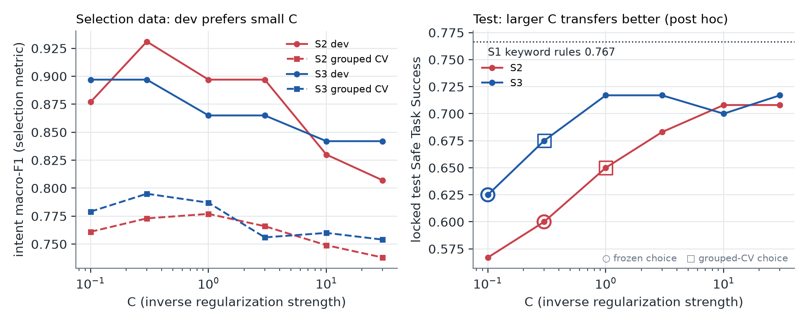
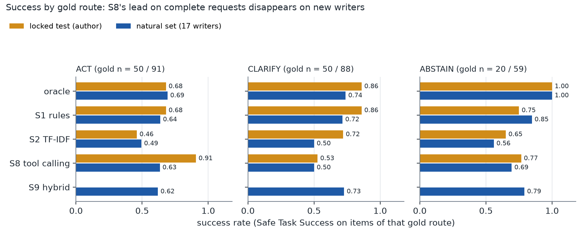

# ATHAR Chat: supplement to the report

Full detail for [report.md](report.md). Sections S6.3-S10 are the complete text of the report
sections with the same number, which the report condenses; appendices A-D follow. Nothing here
adds a result that is not in the report or in the committed outputs it cites.

---

## S6.3 S4 intent recognizers

All test commits ran on Kaggle 2× T4 with pinned revisions and the frozen manifest. Each model ran at
its dev precision. Every report covers exactly the 120 test items.

| Model (precision) | **Primary 6-shot `prior`** [95% CI] | 0-shot `prior` | 6-shot inline (secondary) | Intent acc. | ECE |
|---|---|---|---|---|---|
| Jais 2 8B (nf4, fp32 compute) | **0.758** [0.67, 0.84] | 0.683 | 0.733 | 0.917 | 0.114 |
| Jais-3-3.7B (fp32) | 0.742 [0.65, 0.83] | 0.667 | **0.758** | 0.908 | **0.030** |
| Nile-Chat 4B (fp32) | 0.742 [0.65, 0.83] | 0.575 | 0.725 | 0.925 | 0.060 |
| Qwen3 8B (fp16) | 0.700 [0.61, 0.79] | 0.642 | 0.708 | 0.883 | 0.108 |
| Jais-3-7B (fp16) | 0.550 [0.46, 0.65] | 0.642 | 0.733 | 0.683 | 0.226 |

- **Jais 2, Jais-3-3.7B and Nile-Chat show no detectable difference** on 120 items. No pairwise LLM
  test was pre-registered for test.
- **Few-shot helps on test** (6-shot vs 0-shot `prior`): +0.075 / +0.075 / +0.167 / +0.058. The
  exception is Jais-3-7B with exemplars as chat turns, which declines 34 in-scope requests.
- **Confidence gate (τ from dev).** For Jais 2 (τ = 0.7) it lowers unsafe execution from 0.142 to
  0.083 at a cost in STS (0.758 → 0.700). For the other models the dev τ is 0.

**Pre-registered secondary test: inline vs chat-turn exemplars.** Declared 2026-10-16, before the
test was opened. Family-level paired test, Holm over the two confirmatory models:

| Model | Inline | Chat turns | Difference [95% CI] | Discordant (inline / turns) | p | Holm p |
|---|---|---|---|---|---|---|
| **Jais-3-7B** (confirmatory) | 0.733 | 0.550 | **+0.183** [0.113, 0.258] | 24 / 2 | 0.0001 | **0.0002** |
| Jais 2 8B (confirmatory) | 0.733 | 0.758 | −0.025 [−0.078, 0.024] | 3 / 6 | 0.516 | 0.516 |
| Jais-3-3.7B (descriptive) | 0.758 | 0.742 | +0.017 [−0.024, 0.059] | 4 / 2 | 0.695 | |
| Nile-Chat 4B (descriptive) | 0.725 | 0.742 | −0.017 [−0.063, 0.027] | 3 / 5 | 0.726 | |
| Qwen3 8B (descriptive) | 0.708 | 0.700 | +0.008 [−0.034, 0.051] | 4 / 3 | 1.000 | |

The format effect is specific to Jais-3-7B and replicates from dev to held-out data: with chat-turn
exemplars it over-declines. For Jais 2, the dev advantage (+17 points) did not replicate.

## S6.4 S7: Jais 2 8B + QLoRA (frozen run-6b adapters)

| Scoring | Seed 0 | Seed 1 | Seed 2 | Mean ± SD |
|---|---|---|---|---|
| **`prior` (headline)** | 0.758 [0.68, 0.84] | 0.800 [0.72, 0.88] | 0.800 [0.72, 0.88] | **0.786 ± 0.024** |
| `raw` | 0.767 | 0.800 | 0.775 | 0.781 ± 0.017 |
| `calibrated` | 0.725 | 0.658 | 0.700 | 0.694 ± 0.034 |

- **Intent accuracy is 0.925 / 0.983 / 0.992.** Fine-tuning a pretrained LLM on the same 298 mostly
  drafted items transfers to the author's phrasing; the lexical classifiers do not. The remaining
  failures are the shared core's.
- **Fine-tuned vs zero-shot Jais 2** (declared 2026-10-17 as descriptive), against 0-shot `prior`
  (0.683): seed 0 +0.075 [0.000, 0.153], p = 0.077; seeds 1 and 2 +0.117 [0.063, 0.183],
  p = 0.0003 each.
- **Reproduction check.** The dev rescoring of the frozen adapters reproduced run 6b in 6 of 9 cells;
  the other 3 differ by one item (GPU nondeterminism).

## S6.5 S8: Jais-3-7B end to end through native tool calling

| | Seed 0 | Seed 1 | Seed 2 | Mean ± SD |
|---|---|---|---|---|
| Safe Task Success | 0.758 [0.69, 0.83] | 0.725 [0.65, 0.80] | 0.692 [0.61, 0.77] | **0.725 ± 0.033** |
| intent macro-F1 | 0.941 | 0.930 | 0.882 | 0.918 ± 0.032 |
| unsafe execution | 0.100 | 0.108 | 0.108 | 0.106 ± 0.005 |
| no tool call (plain-text answer) | 11 | 12 | 16 | |
| success: ACT / CLARIFY / ABSTAIN | 0.92 / 0.56 / 0.85 | 0.90 / 0.52 / 0.80 | 0.90 / 0.50 / 0.65 | |

- **Strength: complete requests.** S8 recovers 12-14 of the 15 items that all five S4 models fail
  through the shared core. It almost never asks unnecessarily (0.00-0.02).
- **Weakness: incomplete requests.** 22-25 of the 50 CLARIFY items fail: 8-12 are plain-text answers
  instead of `ask_clarification`; 8-9 are executed with a guessed value; 4-7 ask for the wrong slots.
- **On complete requests,** 4-5 executions per seed fail, of which 0-2 are text-only; the rest are a
  wrong instant or a wrong tool. It never executed an out-of-scope request.

## S7.2 Why the classifiers lost: cue shift and over-regularization

Two causes combine.

**Trigger-word shift.** In training, 88% of reminders use «فكرني» and 5% the noun «تذكير»; in the
test, 50% and 42% (section 3.2). The classifiers' errors are concentrated on the noun form (section
6.1).

**Regularization chosen on dev.** S2 and S3 were frozen with strong L2 regularization (C = 0.3 and
0.1) because those values scored best on dev. Varying only C around each frozen configuration
(`results/posthoc/regularization_sweep.csv`):

| | C | 0.1 | 0.3 | 1 | 3 | 10 | 30 |
|---|---|---|---|---|---|---|---|
| **S2** | train accuracy | 0.940 | 0.956 | 0.977 | 0.997 | 1.000 | 1.000 |
| | dev intent F1 (selection) | 0.877 | **0.931** ◯ | 0.897 | 0.897 | 0.830 | 0.807 |
| | grouped-CV F1 (train+dev) | 0.761 | 0.773 | **0.777** □ | 0.766 | 0.749 | 0.738 |
| | test STS | 0.567 | 0.600 ◯ | 0.650 □ | 0.683 | 0.708 | 0.708 |
| **S3** | dev intent F1 (selection) | **0.897** ◯ | 0.897 | 0.865 | 0.865 | 0.842 | 0.842 |
| | grouped-CV F1 (train+dev) | 0.779 | **0.795** □ | 0.787 | 0.756 | 0.760 | 0.754 |
| | test STS | 0.625 ◯ | 0.675 □ | 0.717 | 0.717 | 0.700 | 0.717 |

◯ frozen (dev) choice; □ choice of a test-blind, family-grouped 5-fold cross-validation on train+dev.

*Figure 3. Left: the selection metric on dev and under grouped cross-validation. Right: locked-test
STS by C (post hoc), with S1 for reference.*

- Dev rewarded the most regularized models; on test, weaker regularization transferred better.
  Even S2 at C = 0.3 misclassifies «ذكرني السبت الجاي الساعة 6 بالليل …», a frame it saw three times
  in training.
- **A better, test-blind selection rule helps only partly.** Grouped cross-validation would have
  chosen C = 1 for S2 (test STS 0.650) and C = 0.3 for S3 (0.675). Both are still below S1 (0.767).
  The best C on test (0.708 / 0.717) is hindsight and is reported only to bound the effect.
- So the direction of H1/H2 does not depend on the selection rule, but the size of the gap does.
  The test-blind rule closes about a third of the 0.14-0.17 deficit; even the best C in hindsight
  leaves S1 ahead by 0.05-0.06.

## S7.3 The shared core's 23 failures (the oracle)

The shared pipeline is deterministic given an intent. `scripts/error_analysis.py` therefore rebuilds
every pipeline system's full test output from the intent it predicted in the locked run, and stops
unless the rebuild reproduces every stored result. All 17 runs (S1-S3, oracle, 10 S4, 3 S7) are
reproduced exactly.

| Cause | n | Example | What happens |
|---|---|---|---|
| **Request framing not recognized** | **15** | «عايز تذكير بكرة الساعة 5 العصر علشان احدث سجل المخاطر» | The framing lexicon has no want-verbs («عايز», «محتاج») and lacks the spelling «اعمللي» (it lists «اعملي», «اعمل لي»). The unrecognized word stays in the reminder text, which in turn stops the connector «علشان» from being stripped as an edge word: extracted «عايز علشان احدث سجل المخاطر». 13 complete reminders fail only on text; «اعمللي تذكير» asks for the wrong slots; «اعمللي تذكير بعد بكرة 7 بالليل» (c017-b) is **executed with the reminder text «اعمللي»** |
| Leftover filler taken as content | 2 | «محتاج تذكير كده», «اعمللي تذكير لو ينفع» | «كده», «لو ينفع» are kept as reminder content, so `reminder_text` is not asked for |
| A vague reminder executed | 2 | «فكرني بكرة الساعة 8 الصبح بحاجة محتاجه ضروري» | executed with text «بحاجة محتاجه ضروري»; gold asks for the content |
| A time word inside a purpose clause | 3 | «ظبطلي منبه الساعة 7 عشان اصحى لصلاة الفجر» | «الفجر» is read as a second time expression, so a complete request gets a time question. All three items set an alarm whose time contradicts its purpose (Fajr at 7 or 9 الصبح, or 9 بالليل) |
| Gold label debatable | 1 | c173-a «فكرني بـ اشغل بلاي ليست الشغل» | gold asks for `reminder_text` although the request names an action |

The earlier version of this report attributed the 13 text failures to the time expression sitting
between «تذكير» and the task. That was wrong: «حطلي تذكير بكرة الساعة 5 العصر عشان …» has the same word
order and is extracted correctly, because «حطلي» is in the framing lexicon.

The table groups failures by root cause. The demo's failure browser and
`results/error_analysis/failures.csv` group the same 23 by outcome instead: 13 wrong reminder text
only, 4 wrong clarification slots, 3 incomplete requests executed, 3 questions asked although the
request was complete.

**What one fix would change** (post hoc, applied in memory only;
`results/posthoc/extractor_fix.csv`). Adding the want-verbs and the «اعمللي» spelling to the framing
lexicon changes no item for the worse on train, dev or test:

| System | Locked STS | With the framing fix |
|---|---|---|
| oracle | 0.808 | **0.925** |
| S1 | 0.767 | 0.883 |
| S2 / S3 | 0.600 / 0.625 | 0.700 / 0.717 |
| S4 Jais 2 / Nile-Chat / Jais-3-3.7B | 0.758 / 0.742 / 0.742 | 0.867 / 0.858 / 0.833 |
| S7 (seeds 0 / 1 / 2) | 0.758 / 0.800 / 0.800 | 0.867 / 0.917 / 0.917 |
| oracle on train / dev | 0.963 / 1.000 | 0.973 / 1.000 |

These numbers were obtained after looking at test failures, so they are not results. They show where
the ceiling is. They motivated core v1.1, which was frozen and then tested on new writers; there
the fix changed one item (section 8.3).

**Safety reading.**
- No pipeline system executed at a wrong instant or executed an out-of-scope request.
- The "unsafe execution" rate of 0.13-0.20 (section 6.1) is mostly text-only mismatches, which run at
  the right time on the right task. Genuinely wrong executions are 3 for the oracle and most LLMs,
  and 9-12 for S2/S3. Wrong-tool errors occur almost only with the classifiers.

## S7.4 Train/test frame overlap

59 of the 120 test items reuse a frame (frame A, section 6.2) that occurs in train; none reuses a
dev frame (`results/posthoc/frame_overlap.csv`). The family split prevents scenario leakage, not
frame leakage.

| System | STS, frame seen in train (59) | STS, unseen frame (61) |
|---|---|---|
| oracle (no training) | 0.898 | 0.721 |
| S1 (no training) | 0.898 | 0.639 |
| S4 Nile-Chat (6 exemplars) | 0.898 | 0.590 |
| S7 seeds 1-2 (fine-tuned) | 0.898 | 0.705 |
| S2 (trained) | 0.661 | 0.541 |
| S8 seed 0 (end to end, no shared core) | 0.746 | 0.770 |

The gap is just as large for systems that never trained on these items (the oracle, S1), and it
disappears for S8, the only system that does not use the shared extractor. The unseen frames are
harder because they contain the framing gap of section 7.3, not because trained systems memorized
seen frames. The overlap therefore does not explain S7's advantage over S2/S3, but it should be
avoided in a future test set.

## S7.5 How close S1's lexicon is to the test

All 100 in-scope test requests contain S1's cue for their gold intent (train 245/247, dev 31/33;
`results/posthoc/lexicon_coverage.csv`). On this test, in-scope intent recognition is a check of
lexicon coverage, and the lexicon and the test were written by the same person. S1's five intent
errors are all out-of-scope requests whose verb the lexicon lacks: «قدم», «خلي», «اخر», and «الغيلي»
(the deletion list has «الغي» but not its suffixed form). The independent native set (appendix A.3)
supports S1 only for out-of-scope requests.

## S7.6 Gold labels a reader may question

Labels cannot change after the test, so these are kept and listed:
- **c017-b** «اعمللي تذكير بعد بكرة 7 بالليل»: gold marks `time` as missing, though «7 بالليل» is a
  usable time (its `reminder_text` is genuinely missing).
- **c173-a**: gold marks `reminder_text` as missing, though the request names an action.
- **c098-a, c098-b, c110-a**: alarms «عشان اصحى لصلاة الفجر» at 7 or 9 الصبح, or 9 بالليل. The stated
  time does not fit the purpose. Gold says ACT; by the contract's rule that an hour which does not
  fit its period is a `time` gap, the system's question is defensible.

Four items in section 7.3 (c008-b, c053-b, c102-b, c110-a) were double-annotated, and the second
annotator agreed with gold on all four.

## S8.1 What was fixed in advance

| When | What | Record |
|---|---|---|
| 2026-10-26 | protocol, hypotheses N1-N3, screening rules, minimum size (60 items, 3 writers) | commit `1c1fbbe` |
| 2026-10-26 | **v2 systems and the evaluation command frozen** (`models_v2/freeze.json`, `8caa1e86…`) | commit `c97afa5` |
| 2026-10-29 | sampling rule (registered before the draw) | commit `de5c069` |
| 2026-11-01 | adjudication rule (before adjudication); gold locked (`1de694ae…`); GPU run settings | protocol log |
| 2026-11-02 | each GPU system run once; `athar-v2 evaluate` run once | `results/natural/` |

**v2 systems** (all frozen before any contributor message was labelled):
- **Core v1.1**: the section 7.3 framing fix (want-verbs and «اعمللي» before a tool noun), five more
  fillers, and no period word read as a time inside a purpose clause after a clock time.
- **S1 v1.1**: S1 with core v1.1 and the out-of-scope verbs S1 missed on the v1 test (section 7.5).
- **S2-gcv, S3-gcv**: S2/S3 with core v1.1, selected by family-grouped 5-fold cross-validation on
  train+dev instead of dev (section 7.2) and refit on train+dev. Chosen: C = 0.3, word 1-2-grams;
  C = 1, word 1-2-grams + char 2-5-grams.
- **S9 hybrid**, computed from each S8 seed's stored output with no further GPU run. S8's decline is
  kept. Otherwise the intent is the tool S8 named (S1 v1.1's intent if S8 answered in plain text),
  and the route comes from the deterministic policy on the core-v1.1 extraction: any blocking gap →
  CLARIFY. On ACT, S8's arguments are used when S8 made the matching call.
- **Hypotheses** (Holm over the three, α = 0.05, on the confirmatory items): **N1** S1 > S2 (replicates
  H1, frozen v1 systems); **N2** S1 v1.1 > S1; **N3** S9 > S8 (per-item mean over the 3 seeds).

S4, S7, S2/S3-gcv and every other comparison are descriptive. S9's design was informed by the v1
test profile (section 6.6) and checked on dev only (S9 0.925-0.975 vs S8 0.700-0.725 on the stored
dev traces) before the freeze.

## S8.2 Data: collection, screening, sampling, labels

**Collection.** Google Forms showed each contributor scenario cards from the 71 test scenarios
(one block of about 15 in wave 2), the typing moment in words, and an A/B design: version B is the
same wish rewritten without what the card says is missing. Contributors were asked to write as they text, without AI tools and without
seeing others' answers.

**Screening** (rules in protocol section 3, applied unchanged to every export): near-duplicates
across submissions, copied form dates, B identical to A, copies of reference texts, and
submission-level rules for copying writers and the author's own codes. The rules were written after
inspecting the first export and are disclosed as such. The pool after screening was **474 messages
from 34 writers**. Forms were regenerated once, before most responses (wave 2b), because the first
version displayed a full date that contributors copied.

**Sample.** Labelling all 474 by two annotators was not feasible in time. A registered rule drew 2
writers per scenario block with a fixed seed, keeping all their messages: **247 messages from 17
writers**. Of these, **238 are confirmatory** (scenario family in neither train nor dev): 70 families,
10-21 items per writer, ACT 91 / CLARIFY 88 / ABSTAIN 59, 84 code-switched, 187 project-management.

**Labels.** The author and a second native annotator (Ibrahim) labelled all 247 items independently
from blank sheets with the unchanged annotation guide. A first pair of returned sheets was rejected
before any analysis: the two sheets were identical, and ACT datetimes copied the sending time.
Agreement before adjudication (`results/natural/agreement.md`):

| Field | n | Agreement | Cohen's κ |
|---|---|---|---|
| intent | 247 | 96.0% | 0.938 |
| route | 247 | 94.3% | 0.913 |
| unsupported reason (both unsupported) | 57 | 89.5% | 0.870 |
| target set (both CLARIFY) | 91 | 64.8% | |
| reminder text (both ACT reminders) | 46 | 89.1% | |
| datetime (both ACT) | 85 | 71.8% | |

The datetime figure counts 11 of the second annotator's daylight-saving offset slips as
disagreements. A frequent target-set disagreement was one annotator adding `date` where no day was
given, which the guide does not treat as a gap.

**Adjudication** (`results/natural/adjudication.json`, ids only). 66 items met the pre-set rule. The
author entered a final label for each; an AI assistant then checked each against the guide and the
contract and corrected 24 where a written rule was broken, and drafted the one-line reasons. The
author approved the result. Final labels: the author's on 13 items, the second annotator's on 39, a
third label on 14. **Deviation:** the protocol planned adjudication by discussion between the two
annotators; the second annotator's part in the decisions is not recorded.

## S8.5 What changed from the author's test

The two sets differ in items, writers and route mix (v1 test: 50 / 50 / 20), so this is descriptive.

| System | v1 test (author, 120) | Natural (contributors, 238) | Change |
|---|---|---|---|
| oracle | 0.808 | 0.786 | −0.023 |
| S1 | 0.767 | 0.718 | −0.048 |
| S2 / S3 | 0.600 / 0.625 | 0.513 / 0.513 | −0.087 / −0.112 |
| S7 (3 seeds) | 0.786 | 0.730 | −0.056 |
| S8 (3 seeds) | 0.725 | 0.599 | −0.126 |
| S4 Jais 2 8B | 0.758 | 0.618 | −0.140 |
| S4 Nile-Chat 4B | 0.742 | 0.664 | −0.078 |
| S4 Jais-3-3.7B | 0.742 | 0.744 | +0.002 |
| S4 Qwen3 8B | 0.700 | 0.718 | +0.018 |
| S4 Jais-3-7B | 0.550 | 0.664 | +0.114 |

*Figure 4. Success by gold route on the locked test (author, 120 items) and the natural set (17
writers, 238 confirmatory items). S8 and S9: mean of 3 seeds; S9 was not run on the locked test.
Generated by `scripts/make_figures.py` from the committed outputs.*

**The fixes fitted the author, not the task.** On the 117 (card, version) slots both wrote, the v1.1
systems reach 0.974 (S1 v1.1, oracle v1.1) on the author's items and 0.715 / 0.785 on the
contributors'. The v1 systems show gaps of 0.04-0.11 on the same slots; the v1.1 systems 0.19-0.26.
Because v1.1 was built from the error analysis of exactly those author items, its author score is
not a held-out result. The pattern is the expected signature of fixing errors on a test set: the
framing gap of section 7.3 was a property of the author's frames, and on contributors' messages the
fixed patterns changed the outcome of one item. This is the outcome N2 was registered to detect.

**S8's advantage on complete requests did not transfer.** On the author's test S8 succeeded on
0.907 of ACT items against the oracle's 0.680 (section 6.6). On contributors' messages it reached
0.634, below the oracle's 0.692. The failure split of section 8.7 shows why: S8 and the core get
the instant wrong about equally often (7.3 and 7 of 91 ACT items) and lose most ACT items on the
exact reminder text (21.7 and 17). On the author's test, by contrast, 0-2 of S8's ACT failures per
seed were text-only, and the core's ACT failures came from the framing gap (section 7.3). With the
lenient text rule, S8 reaches 0.690 and the oracle 0.857 (section 8.7). S8's CLARIFY success stayed
low (0.527 → 0.500), and 23-25 answers per seed (10% of items) were plain text without a tool call.
So the complementary-profile picture of section 6.6 was partly a property of the author's phrasing:
on these messages S8 does not extract times better than the rules.

**S8 is a lower bound for Jais 3 tool calling.** It ran zero-shot with sampled decoding (T 0.7,
reasoning effort high), without exemplars, without the annotation guide in its prompt beyond the
contract's time rules, and without structured or constrained decoding (section 4).

**Jais-3-7B's chat-turn exemplar problem replicates** (descriptive): inline exemplars 0.723 vs chat
turns 0.664, 21 / 7 discordant items, exact McNemar p = 0.013. For the other four models the
difference is small and not significant (Jais 2 +0.025; Jais-3-3.7B, Nile-Chat and Qwen3 −0.009 to
−0.034).

## S8.6 Where the hybrid gains

Item-level comparison of S9 with S8, per seed:

| | Seed 0 | Seed 1 | Seed 2 |
|---|---|---|---|
| S9 right, S8 wrong | 39 | 28 | 35 |
| S8 right, S9 wrong | 11 | 8 | 10 |
| of which on CLARIFY items (S9 only / S8 only) | 29 / 9 | 22 / 6 | 30 / 6 |
| on ABSTAIN items | 9 / 0 | 5 / 0 | 3 / 0 |
| on ACT items | 1 / 2 | 1 / 2 | 2 / 4 |
| S8 answers without a tool call / of these, S9 right | 23 / 22 | 24 / 16 | 25 / 18 |

The gain comes from the policy deciding *when* to act, not from better arguments. S9 asks when a
detail is missing (CLARIFY), turns plain-text answers into a valid route, and keeps S8's declines.
On complete requests it is slightly worse than S8: in every such loss, core v1.1 reported a gap on
a request that S8 had executed correctly, and S9 asked instead. A hybrid that also used the LLM's
arguments when the core reports a gap that the LLM resolved is the obvious next variant; it was not
pre-registered and is not evaluated here.

## S8.7 Sensitivity of the confirmatory results (post hoc)

Three choices could have shaped N1 and N3: the adjudication (in which the author, assisted by an AI
check against the guide, set the final labels; section 8.2), the strict reminder-text rule, and the
expressions the contract does not resolve. `scripts/natural_sensitivity.py` rescores the frozen
systems under each alternative and reruns the pre-registered paired test. It was run after the
locked evaluation and changes nothing in it; the p-values are not Holm-adjusted.

| Labels / rule | n | S1 | S2 | N1 diff [95% CI], p | S8 | S9 | N3 diff [95% CI], p |
|---|---|---|---|---|---|---|---|
| locked gold (pre-registered) | 238 | 0.718 | 0.513 | +0.206 [0.129, 0.287], 0.0001 | 0.599 | 0.702 | +0.102 [0.051, 0.156], 0.0005 |
| author's labels before adjudication | 238 | 0.588 | 0.429 | +0.160 [0.099, 0.222], 0.0001 | 0.531 | 0.606 | +0.076 [0.032, 0.119], 0.0011 |
| second annotator's labels | 237 | 0.671 | 0.485 | +0.186 [0.112, 0.263], 0.0001 | 0.558 | 0.655 | +0.097 [0.049, 0.148], 0.0006 |
| lenient reminder text | 238 | 0.790 | 0.584 | +0.206 [0.129, 0.287], 0.0001 | 0.690 | 0.789 | +0.098 [0.046, 0.152], 0.0006 |
| without uncovered expressions | 224 | 0.746 | 0.527 | +0.219 [0.139, 0.304], 0.0001 | 0.613 | 0.725 | +0.112 [0.057, 0.167], 0.0003 |

The second annotator's labels use only the format fixes of adjudication (no reminder text on alarms,
Cairo wall-clock time); one item whose label is then invalid is dropped. "Uncovered expressions"
are «بعد اسبوع/شهر», «X بعد الجاي», «الاسبوع اللي بعد اللي جي» and «بدقايق» (14 confirmatory items).

- **Both conclusions are robust.** N1 and N3 keep their sign and p ≤ 0.0011 under every alternative.
- **Adjudication raised absolute scores and widened both gaps.** Against the author's
  pre-adjudication labels, every system scores 0.07-0.13 lower, and the systems built on the
  contract gained most (S1 +0.130, oracle +0.126, S9 +0.096, S2 +0.084, S8 +0.068). Correcting labels
  towards the guide favours the systems that implement it. Against the author's pre-adjudication
  labels the gaps are 0.046 (N1) and 0.026 (N3) smaller; against the second annotator's, 0.020 and
  0.005.
- **A label inconsistency in the locked gold.** «X بعد الجاي» is a `date` gap in c102-b-d1 but
  resolved in c102-a-d1, c002-a-f2, c002-b-f2 and c017-a-w4. Locked labels are not changed;
  removing all uncovered-expression items (last row) does not change the conclusions.

**ACT failures on the locked gold** (91 gold-ACT items; S8, S9: mean over seeds):

| System | wrong tool | wrong instant | text only | not executed |
|---|---|---|---|---|
| oracle | 0 | 7 | 17 | 4 |
| S1 | 0 | 7 | 17 | 9 |
| S2 | 10 | 5 | 17 | 14 |
| S8 | 2.3 | 7.3 | 21.7 | 2 |
| S9 | 2 | 8 | 20.7 | 4 |

Most failed complete requests fail on the exact wording of the reminder text, for the LLM and the
rules alike; wrong instants are rarer and about equally frequent. The strict text rule (the user's
own words after canonicalisation) is therefore the main reason ACT success is low on this set.

## S8.8 Integrity and deviations

- **Order of events.** Systems, evaluation code and hypotheses were committed before labelling
  started. The gold was locked before any system saw it. GPU outputs were committed before
  `athar-v2 evaluate`, which ran once and refuses to overwrite its output.
- **GPU runs.** Five Kaggle commits (2× T4), each with notebook 2026-10-26a, the locked set
  (`1de694ae…`) and the pinned model revisions, as recorded in each run's `environment.json`. The
  settings of each commit were logged before the runs. To avoid hand-editing slips, they were
  generated by `scripts/natural_run_notebooks.py`. Two commits did not score the set and are logged:
  one ran the default dev prompt check, and one S7 attempt stopped before scoring because the
  adapter dataset was not attached; it was re-run unchanged.
- **Reproduction checks.** S7's dev rescoring reproduced run 6b exactly. The CPU rebuild reproduced
  all stored S4/S7 scores.
- **Deviations** (all logged with timing): the wave-2b form change; early collection close (target
  exceeded); a labelled sample instead of all items; the rejected first sheets; adjudication without
  a recorded joint discussion, with AI-assisted rule checking.

## S10 Limitations and threats to validity

1. **One templated writer (sections 6-7).** The locked test is one person's second-pass phrasing
   from a small set of frames (section 3.2), and that person also wrote S1's lexicon and designed
   the system. Section 8 tests the main conclusions on 17 other writers: H1 replicates; the
   extractor fixes and S8's argument advantage do not.
2. **Statistical dependence.** The pre-registered family clustering ignores shared frames. Under
   frame clustering, H1/H2 are borderline (section 6.2).
3. **Selection on a tiny drafted dev set.** Dev (40 items, 17 families) chose the classifiers'
   regularization, τ and the S4/S7 settings. It did not predict test (section 7.1), and it
   explains part of the H1/H2 gap (section 7.2).
4. **Synthetic-to-real shift.** Training and dev are 88% and 98% AI-drafted, because the human texts
   available at the freeze were needed for test (section 3.2), and the trigger wording differs
   sharply from the test. H1/H2 and N1 therefore compare the rules with classifiers *trained on
   drafted data*; section 9.2 shows that human training data close most of the gap (post hoc).
5. **Frame overlap.** 59/120 test items reuse a training frame (section 7.4). It does not explain the
   ranking, but it is a form of leakage the family split cannot catch.
6. **Small samples.** On 120 items, STS intervals are about ±0.09; LLM rankings are not resolvable.
7. **Strict text matching.** STS requires an exact canonical reminder text; a lenient variant leaves
   the H1-H3 differences unchanged (section 6.1).
8. **Debatable gold labels** in five test items (section 7.6), kept unchanged.
9. **Precision and decoding confounds.** On T4, Jais 2 (S4, S7) ran in 4-bit; the other models in
   fp16/fp32. S8 is sampled and zero-shot, S4 deterministic and 6-shot.
10. **Analytic flexibility in S4 and S7** (section 5). H1-H3 are unaffected.
11. **S5/S6 are post hoc.** Their recipes were fixed in `configs/train.yaml` before the test, but
    they were first fit and scored on 2026-11-05, after both evaluations had been read (section 9.1).
    They are evidence about the model class, not confirmatory results.

**Limits of the natural-phrasing evaluation (section 8).**

12. **Elicited, not organic, requests.** Contributors wrote for the author's scenario cards with an
    A/B design. Wording is theirs; scenarios, route mix and the kind of missing detail are not.
    Messages from real assistant use may differ further.
13. **Who the writers are.** Contributors were recruited through the author's network and are
    identified by code only; dialect region, age and typing habits were not recorded. Screening
    rules were written after inspecting the first export (disclosed), and the 17 writers are a
    seeded sample of 34.
14. **The labels involve the author.** The author is one of the two annotators and approved every
    adjudicated label; the second annotator's part in adjudication is not recorded, and an AI
    assistant checked the adjudicated labels against the guide (section 8.2). Agreement before
    adjudication was high for intent and route (κ 0.94 / 0.91) and lower for target sets (65%) and
    datetimes (72%), so the CLARIFY and ACT details carry more label uncertainty than the routes.
15. **The contract's coverage.** Contributors used expressions the frozen contract does not resolve
    («بعد اسبوع», «بعد شهر», «الخميس بعد الجاي», «بدقايق»). They are labelled as gaps by the guide's
    "never guess" rule; another contract could label them ACT.
16. **Same-system comparison in N3.** S9 is built from S8's own outputs, so N3 measures what the
    policy adds to S8, not a comparison between independent systems.
17. **Adjudication favours the contract-based systems.** Adjudicated labels follow the guide that
    the rule core implements; they raised the rule-based systems' STS more than S8's. The confirmed
    findings hold without adjudication (section 8.7), but their size depends on it. The locked gold
    also treats «X بعد الجاي» inconsistently across five items (section 8.7).
18. **S8 is a lower bound for Jais 3 tool calling** (zero-shot, sampled, no structured decoding;
    section 8.5), so N3 says what the policy adds to this configuration, not to the best one.

**Limits of the post hoc analyses (section 9).**

19. **The human-data experiment trains on the evaluation set.** Section 9.2 uses cross-validation
    within the 247 locked messages. No held-out writer or scenario is ever trained on, but the
    hyper-parameters, the scenario pool and the labelling conventions are shared across folds.
    After this analysis the natural set is no longer untouched evidence for a future system.
20. **One annotation pass for the training labels.** The contributor labels used for training in
    section 9.2 are the adjudicated gold, which the author approved (limitation 14).
21. **Heuristic phenomenon tags.** The tags of section 9.3 are regular expressions on the raw text.
    They overlap, and several cells are too small to read.

## Appendix A. Development results (40 dev items, 39 AI-drafted)

Dev drove the development decisions; section 7.1 shows it did not predict test.

### A.1 Core systems

S1 0.800 [0.59, 0.95]; S2 **0.950** [0.88, 1.00]; S3 0.925 [0.84, 1.00]; oracle 1.000. No
difference was significant (S2 vs S1 +0.150, Holm p = 0.80).

### A.2 S4

| Model | Primary (6-shot `prior`) | Best other setting |
|---|---|---|
| Jais-3-3.7B | 0.950 | 0.950 (several) |
| Nile-Chat 4B | 0.900 | 0.875 |
| Qwen3 8B | 0.850 | 0.875 (6-shot `raw`) |
| Jais-3-7B | 0.825 | 0.975 (0-shot `calibrated`) |
| Jais 2 8B | 0.725 | 0.925 (0-shot `prior`) |

### A.3 Native Egyptian out-of-scope recall (192 requests, independent native writer)

| System | Recall [95% Wilson CI] |
|---|---|
| Jais-3-7B | **1.000** [0.980, 1.000] |
| S7 (seeds 0/1/2) | 1.000 / 0.990 / 0.990 |
| S1 | 0.990 [0.963, 0.997] |
| Qwen3 8B | 0.974 [0.940, 0.989] |
| Jais 2 8B / Nile-Chat 4B | 0.964 [0.927, 0.982] |
| Jais-3-3.7B | 0.958 [0.920, 0.979] |
| S2 / S3 | 0.870 [0.815, 0.910] / 0.865 [0.809, 0.906] |

- **Paired McNemar.** Jais 2 → Jais-3-7B 0 / 7 discordant (p = 0.016); Nile-Chat → Jais-3-3.7B 4 / 3
  (p = 1.0).
- **No dialect gap.** S1-S3 on the same requests in their MSA originals: 0.979 / 0.865 / 0.859.
- **Caveats.** Jais 2 ran in 4-bit, the native set informed the S4 method choice, and the p-values
  are not multiplicity-adjusted. The set has almost no in-scope requests.

### A.4 Few-shot format, S7 training, S8 (dev)

- **Exemplar format** (run 4, three exemplar sets). Inline exemplars beat chat turns in every set:
  Jais 2 0.875 vs 0.708, Jais-3-7B 0.900 vs 0.825. Fixing Jais 2's answer role (`ai`) made no
  difference (11 vs 12 discordant, p = 1.0).
- **S7 training stability.** With one optimizer step per item at a constant LR, `raw` STS by seed was
  0.925 / 0.325 / 0.650: label-bias collapse, not lost discrimination (calibration on the same weights
  recovered 0.875). With the pre-registered S6 recipe (batch 16, 10% warm-up and linear decay,
  clipping at 1.0, class-balanced loss, answers ending in the template's `<|eot_id|>`) it became
  0.950 / 0.925 / 0.925. The components changed together, so the fix is not attributed to any one.
- **S8 on dev.** STS 0.717 ± 0.014 and intent F1 0.924. 18 of 120 answers were plain-text replies
  instead of tool calls.

## Appendix B. Cost

| System | Training | Inference |
|---|---|---|
| S1 | none | 0.011 ms per item (CPU) |
| S2 | 0.08 s CPU (12-fit search: 0.7 s) | 0.054 ms per item (CPU) |
| S3 | 0.30 s CPU (36-fit search: 18 s) | 0.214 ms per item (CPU) |
| S4 (5 models) | none | 40-182 min per model per test commit on 2× T4 (9 settings plus the 9-perturbation robustness suite, on 120 items) |
| S7 | about 60 min per seed on 2× T4 (run 6b) | 4-bit Jais 2 forward passes, as S4 |
| S8 | none | 144 min for 3 seeds × 120 items on 2× T4, about 24 s per request (reasoning + tool call) |

The GPU times are wall-clock for whole notebook commits, not tuned latency benchmarks. S4 scores
each label with a separate forward pass over the whole prompt; caching the shared prompt would
remove most of that repeated work.

## Appendix C. Notes for Jais practitioners

Each point was verified in this project, against the pinned revisions and the models' own chat
templates.

- **Jais 3 chat template.** Every assistant turn needs a thinking field; the template raises an error
  without one. The generation prompt opens a reasoning block (`<ifm|think>`). To score a label
  directly, send few-shot answers with an empty `reasoning_content` and append `</ifm|think>` to the
  prompt; that reproduces exactly how the template writes an answer with no reasoning (checked by
  `llm.answer_consistent` on the real template, a test fixture).
- **Jais 3 loading.** It needs `trust_remote_code` (`K2HorizonForCausalLM`). Pin revisions: a Hub
  history rewrite on 2026-10-16 made earlier commit hashes unresolvable, though every file we checked
  was byte-identical.
- **Jais 2 chat template.** Roles are written literally, and the answer opens under
  `<|start_header_id|>ai<|end_header_id|>`. Few-shot answers should use the role `ai`, though on our
  data this made no measurable difference. The template ends a turn with `<|eot_id|>`; train
  fine-tuned answers to end with it.
- **Tokenizers.** Jais 2 and Jais 3 encode all three Arabic labels in 2 tokens each, so summed
  verbalizer scores carry no length bias for them. Nile-Chat (3/2/4) and Qwen3 (4/2/4) do not.
- **Precision on T4 (no native bf16).** Jais 2 8B overflowed in fp16 and ran in 4-bit NF4 with fp32
  compute. Jais-3-7B ran in fp16 without overflow.
- **Few-shot format.** Jais-3-7B is strongly sensitive to exemplars given as chat turns: it
  over-declines in-scope requests, and inline exemplars add +18 STS points on test. Report the
  exemplar format with any few-shot Jais-3-7B result.
- **Out-of-scope behaviour.** Jais-3-7B declined 192/192 native out-of-scope Egyptian requests.
- **Tool calling (Jais 3).** Its argument extraction from Egyptian requests beats our rule-based
  extractor on complete requests. In 9-15% of answers it replies in plain text where a tool call is
  required, and it may execute an incomplete request with a guessed value. A strict tool contract
  needs constrained decoding, or a validator that turns a plain-text question into a clarification.
- **QLoRA on Jais 2.** One optimizer step per example at a constant LR made the label bias depend on
  the seed. Batched, scheduled, clipped, class-balanced updates removed this. With that recipe, 298
  mostly drafted examples gave test intent accuracy of 0.93-0.99.

## Appendix D. Reproducibility

| Item | Value |
|---|---|
| Split manifest | `data/splits/manifest.json`, `940beba352ec…` |
| Freeze used by the locked core run | `d9bc40cf9473…` (`results/test_results.json`). The current `models/freeze.json` gives identical predictions (section 5) |
| Eval config | `configs/eval.yaml`, SHA-256 `dfbd8398c8c3…` (recorded in every report) |
| Model revisions | Jais-3-7B `94d69f49b4af`, Jais-3-3.7B `3d5754d5db87`, Jais-2-8B-Chat `da0e1639cd92`, Nile-Chat-4B `2a365667659b`, Qwen3-8B `b968826d9c46` |
| S7 adapters | SHA-256 in [jais3.md](jais3.md), section 13 |
| GPU notebook | `notebooks/kaggle_s4_llm.ipynb` (S4 test: 2026-10-17a; S7/S8 test: 2026-10-18b); CPU rehearsal: `scripts/smoke_kaggle_notebook.py [--split test]` |
| Environment | Kaggle 2× T4, torch 2.11.0, transformers 5.19.0, peft 0.20.0, bitsandbytes 0.50.2. Kaggle ran Python 3.13.15 (`environment.json`), and the notebook installs the `athar` wheel with `--ignore-requires-python`, because `pyproject.toml` declares `>=3.11,<3.13`; the CPU commands ran on Python 3.11 in the local `uv` environment |
| Test outputs | `results/test_results.json` (S1-S3, oracle, H1-H3); `results/s4/7a-jais3/`, `7b-others/`, `7cd-s7-s8/` |
| Post hoc outputs | `results/error_analysis/`, `results/posthoc/`, `docs/figures/`; record: [posthoc_analyses.md](posthoc_analyses.md) |
| Dev outputs | `results/dev/` (the external Egyptian test file is not copied; the notebook downloads it at a pinned revision) |
| Details | [jais3.md](jais3.md) (LLM runs), [evaluation_protocol.md](evaluation_protocol.md) (design, deviations), [data_card.md](data_card.md), [agreement.md](agreement.md) |
| Natural set (section 8) | `data/natural/natural.jsonl`, manifest `data/natural/manifest.json` (`1de694ae…`); sample record `data/natural/sample.json` |
| v2 freeze | `models_v2/freeze.json`, `8caa1e86…` (`athar-v2 verify`) |
| Natural outputs | `results/natural/` (`evaluation.json`, `tables.md`, `agreement.*`, `adjudication.json`, `kaggle/1-s8 … 5-s7/`); design and dated log: [protocol_natural.md](protocol_natural.md) |

### How each result was produced

Every GPU run is one Kaggle commit (2× T4) of `notebooks/kaggle_s4_llm.ipynb`. The notebook version
is read from each run's own `environment.json`. Flags not listed were off.

| Run | Split | Notebook | Flags | Output |
|---|---|---|---|---|
| 1 prompt check | dev | 2026-10-15b | `RUN_PROMPT_CHECK` | `results/dev/2026-10-15-run1-prompt-check/` |
| 2 S4 Jais 3 | dev | 2026-10-16a | `RUN_S4`, `RUN_EGYPTIAN_OOD`, `RUN_MODELS=["jais3-7b","jais3-3.7b"]` | `results/dev/2026-10-16-run2-jais3/` |
| 3 S4 other models | dev | 2026-10-16a | `RUN_S4`, `RUN_EGYPTIAN_OOD`, `RUN_MODELS=["jais2-8b","nile-4b","qwen3-8b"]` | `results/dev/2026-10-16-run3-others/` |
| 4 exemplar format | dev | 2026-10-16a | `RUN_SHOT_STYLE` | `results/dev/2026-10-16-run4-shotstyle/` |
| 5 S8 | dev | 2026-10-16a | `RUN_S8` | `results/dev/2026-10-16-run5-s8/` |
| 6 S7, first training loop | dev | 2026-10-16a | `RUN_S7_QLORA` | `results/dev/2026-10-17-run6-s7/` |
| 6b S7, S6-recipe training | dev | 2026-10-17a | `RUN_S7_QLORA` | `results/dev/2026-10-18-run6b-s7/` |
| 7a S4 Jais 3 | **test** | 2026-10-17a | `SPLIT="test"`, `UNLOCK_TEST`, `RUN_S4`, `RUN_MODELS=["jais3-7b","jais3-3.7b"]`, `GATE_TAU` from runs 2-3 | `results/s4/7a-jais3/` |
| 7b S4 other models | **test** | 2026-10-17a | as 7a, `RUN_MODELS=["jais2-8b","nile-4b","qwen3-8b"]` | `results/s4/7b-others/` |
| 7c+7d S7 frozen, S8 | **test** | 2026-10-18b | `SPLIT="test"`, `UNLOCK_TEST`, `RUN_S7_QLORA` (`S7_FROZEN`), `RUN_S8` | `results/s4/7cd-s7-s8/` |
| nat-1 S8 | natural | 2026-10-26a | `EVAL_MANIFEST` = natural, `SPLIT="test"`, `UNLOCK_TEST`, `RUN_S8` | `results/natural/kaggle/1-s8/` |
| nat-2 S4 Jais 3 | natural | 2026-10-26a | as nat-1, `RUN_S4`, `RUN_MODELS=["jais3-7b","jais3-3.7b"]`, v1 `GATE_TAU` | `results/natural/kaggle/2-s4-jais3/` |
| nat-3 S4 Jais 2 | natural | 2026-10-26a | as nat-2, `RUN_MODELS=["jais2-8b"]` | `results/natural/kaggle/3-s4-jais2/` |
| nat-4 S4 Nile, Qwen | natural | 2026-10-26a | as nat-2, `RUN_MODELS=["nile-4b","qwen3-8b"]` | `results/natural/kaggle/4-s4-nile-qwen/` |
| nat-5 S7 frozen | natural | 2026-10-26a | as nat-1, `RUN_S7_QLORA` (`S7_FROZEN`) instead of `RUN_S8` | `results/natural/kaggle/5-s7/` |

The natural runs' notebooks are generated by `scripts/natural_run_notebooks.py`; only the settings
lines differ from `notebooks/kaggle_s4_llm.ipynb`.

CPU, local:

| Result | Command | Output |
|---|---|---|
| S1-S3 and the oracle on test, H1-H3 (once, 2026-10-18) | `athar-eval --manifest data/splits/manifest.json --models models --split test --unlock-test` (refuses to run once its output exists) | `results/test_results.json` |
| S1-S3 on the native Egyptian set | `athar-ood --models models --systems S1 S2 S3` | `results/dev/ood/core_2026-10-18.json` |
| Paired native out-of-scope comparisons | from runs 2-3 | `results/dev/egyptian_paired_2026-10-16.csv` |
| Error analysis (post hoc) | `uv run python scripts/error_analysis.py` | `results/error_analysis/` |
| Sensitivity, overlap, C sweep, extractor fix (post hoc) | `uv run python scripts/posthoc_analysis.py` | `results/posthoc/` |
| Figures | `uv run --with matplotlib python scripts/make_figures.py` | `docs/figures/` |
| Natural set: N1-N3 and every system, once (2026-11-02) | `athar-v2 evaluate --natural data/natural/manifest.json --s8-traces <3 traces> --llm-results <S4/S7 reports> --out results/natural/evaluation.json` (refuses to overwrite) | `results/natural/evaluation.json` |
| Natural set: report tables | `uv run python scripts/natural_tables.py` | `results/natural/tables.md` |
| Natural set: sensitivity (post hoc) | `uv run --with openpyxl python scripts/natural_sensitivity.py` (needs the private labelling sheets) | `results/natural/sensitivity.md`, `.json` |
| Natural set: agreement, adjudication | `athar-data kappa …`; `scripts/adjudicate_natural.py sheet / apply` | `results/natural/agreement.*`, `adjudication.json` |
| S5/S6 on the locked test and the natural set (post hoc, section 9.1) | `uv run --extra neural python scripts/posthoc_encoders_human.py encoders` (MARBERTv2 and e5-small at the pinned revisions; about 20 min per S6 seed on CPU) | `results/posthoc/encoders.json` |
| Training on contributors, leave-one-writer-out (post hoc, section 9.2) | `uv run --extra neural python scripts/posthoc_encoders_human.py human` | `results/posthoc/human_training.json` |
| STS by phenomenon (post hoc, section 9.3) | `uv run python scripts/posthoc_phenomena.py` | `results/posthoc/phenomena.md`, `.json` |
